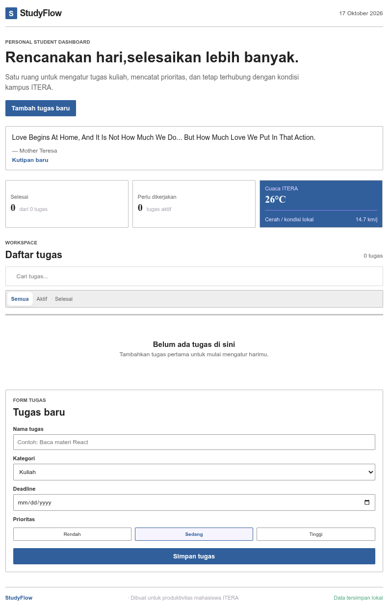

# StudyFlow — Personal Student Dashboard

Identitas
- Nama: Febrian Yoel Anggara Saputra
- NIM: 124140031
- Kelas: RB
- Pertemuan: 2 — JavaScript Next Gen (ES6+)

## Deskripsi

StudyFlow adalah personal dashboard untuk membantu mahasiswa ITERA mengatur tugas kuliah sehari-hari. Pengguna dapat menambahkan tugas berdasarkan kategori, deadline, dan prioritas; menandai tugas selesai; mencari dan memfilter tugas; serta mengedit atau menghapus data. Data tersimpan di `localStorage`, sehingga tetap ada ketika halaman dimuat ulang.

Dashboard juga menampilkan kutipan motivasi dari DummyJSON dan cuaca real-time sekitar ITERA dari Open-Meteo menggunakan `async/await`.

## Fitur

- Tambah, edit, hapus, dan tandai tugas selesai.
- Filter tugas: semua, aktif, dan selesai.
- Pencarian tugas secara langsung.
- Kategori: Kuliah, Praktikum, Organisasi, dan Pribadi.
- Deadline dan indikator prioritas.
- Statistik tugas selesai dan tugas aktif.
- Penyimpanan persisten dengan `localStorage`.
- Kutipan motivasi dan cuaca ITERA dari API publik gratis.
- Tampilan responsif untuk desktop dan mobile.

## Cara Menjalankan

1. Buka folder ini di Visual Studio Code.
2. Jalankan `index.html` menggunakan Live Server. Jangan menggunakan double-click `file://` karena aplikasi menggunakan ES Modules dan membutuhkan server lokal.
3. Data tugas akan tersimpan otomatis di browser yang digunakan.

## Implementasi ES6+

| Fitur | Implementasi | Lokasi |
|---|---|---|
| `let` dan `const` | State, konstanta API, dan referensi DOM | `script.js:1-8` |
| Arrow function | `formatDate`, `formatShortDate`, `escapeHtml`, callback event dan array methods | `script.js:6-8, 37-42` |
| Template literals | Rendering kartu tugas dan format teks dinamis | `script.js:61-65` |
| Destructuring | Parameter `TaskItem`, hasil API, dan callback event | `script.js:10, 31, 38, 47-48` |
| Spread operator | Memperbarui state tugas secara immutable | `script.js:28-29` |
| Classes | `TaskItem` untuk model data dan `DashboardApp` untuk state/aplikasi | `script.js:10-16` |
| Higher-order functions | `map`, `filter`, `find`, `forEach`, `Promise.allSettled` | `script.js:28-49` |
| Async/await | Mengambil kutipan dan cuaca dari API publik | `script.js:47-49` |
| Modules | `main.js` mengimpor `DashboardApp` dari `app.js`; `app.js` mengimpor helper dan data API | `js/main.js:1`, `js/app.js:1-2` |
| Default parameters | `TaskItem` menggunakan nilai default kategori, prioritas, dan status | `js/app.js:8` |
| Enhanced object literals | `taskData` memakai shorthand property dan `Object.assign` | `js/app.js:52-53, 8-9` |
| Promise utilities | `Promise.allSettled` menjalankan fetch independen secara paralel | `js/app.js:85` |

## API Publik yang Digunakan / Direkomendasikan

1. Open-Meteo — cuaca real-time tanpa API key:
   `https://api.open-meteo.com/v1/forecast?latitude=-5.36&longitude=105.31&current_weather=true`
2. DummyJSON Quotes — kutipan acak tanpa API key:
   `https://dummyjson.com/quotes/random`
3. JSONPlaceholder — data tugas simulasi tanpa API key:
   `https://jsonplaceholder.typicode.com/todos?_limit=5`

## Screenshot

Screenshot antarmuka dapat ditambahkan setelah aplikasi dijalankan:

## Catatan

Jika API sedang tidak dapat diakses, dashboard tetap dapat digunakan dan menampilkan fallback untuk kutipan/cuaca. Tugas yang tersimpan di `localStorage` tidak bergantung pada koneksi internet.
