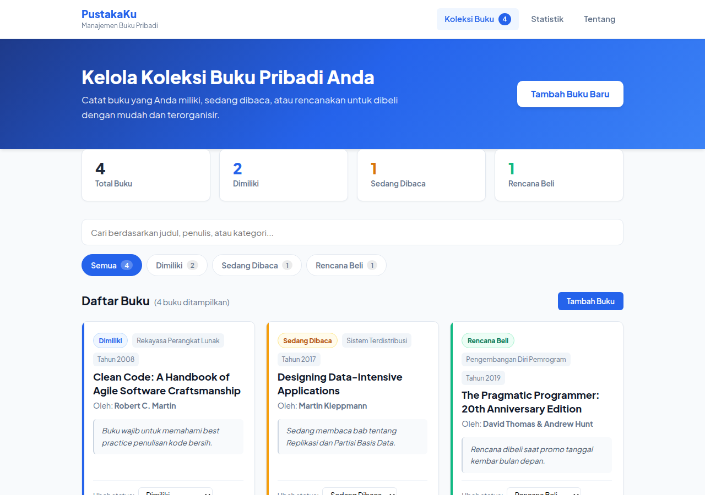
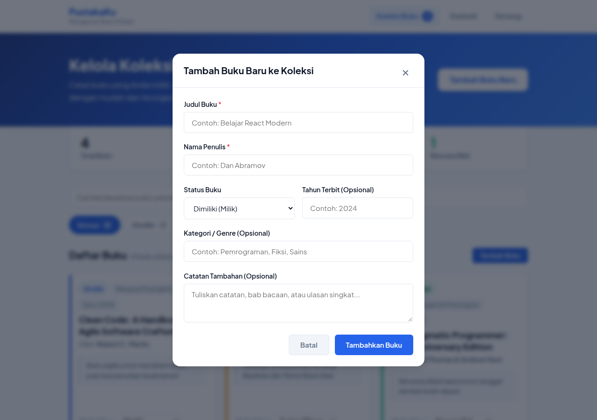
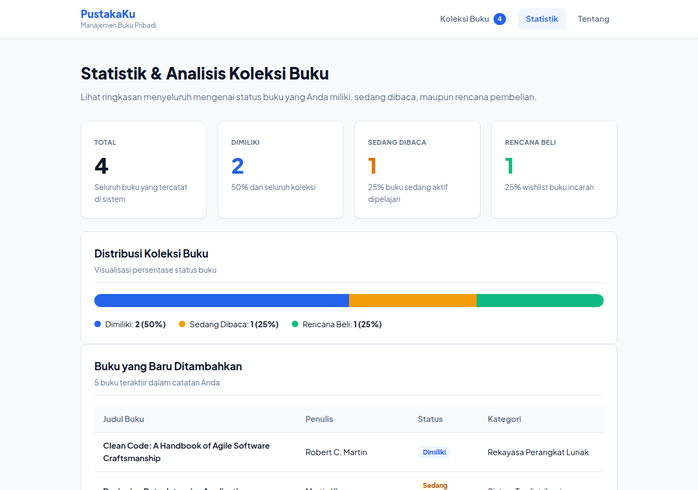
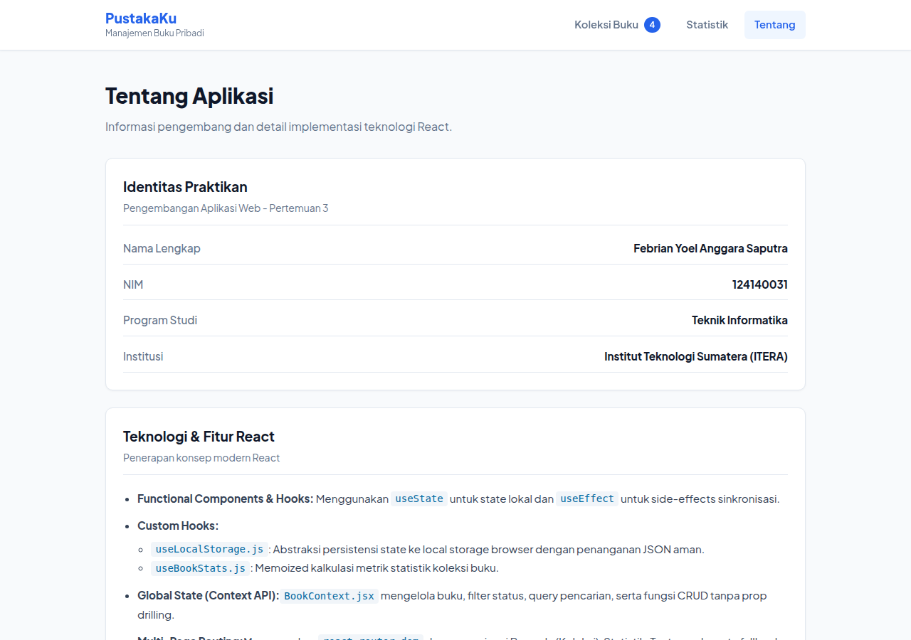
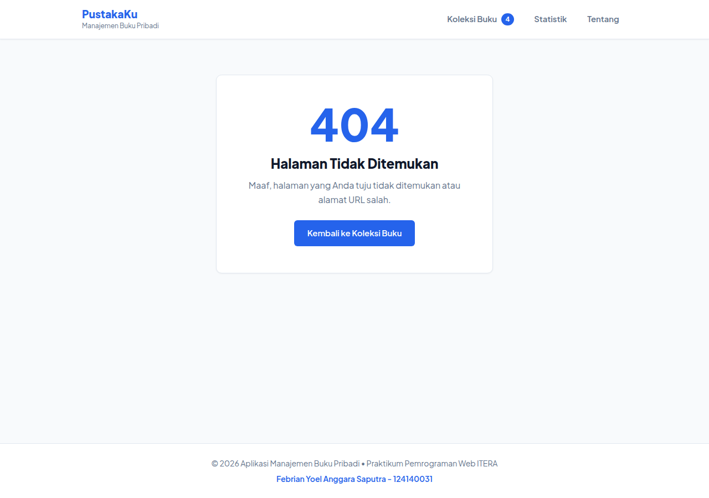

# Aplikasi Manajemen Buku Pribadi (PustakaKu)

**Praktikum Pengembangan Aplikasi Web (PAW)**  
**Pertemuan 3: React Basics**  
**Teknik Informatika - Institut Teknologi Sumatera (ITERA)**

---

### Identitas Praktikan
- **Nama**: Febrian Yoel Anggara Saputra
- **NIM**: 124140031
- **Kelas Praktikum**: RB
- **Tahun Ajaran**: 2026/2027 Ganjil

---

## 1. Deskripsi Aplikasi

**PustakaKu** adalah aplikasi web berbasis React yang dirancang untuk membantu pengguna mengelola, mendokumentasikan, dan memantau koleksi buku pribadi secara terstruktur dan efisien.

Aplikasi ini mencakup:
1. **Pencatatan Buku**: Menambah buku baru beserta data judul, penulis, status, tahun rilis, kategori, dan catatan refleksi bacaan.
2. **Kategorisasi Status**: Mengelompokkan buku ke dalam 3 status utama:
   - **Dimiliki (Milik)**: Buku fisik/digital yang sudah dimiliki.
   - **Sedang Dibaca (Baca)**: Buku yang sedang aktif dibaca.
   - **Rencana Beli (Beli)**: Wishlist buku yang ingin dibeli.
3. **Filter & Pencarian Real-Time**: Pencarian cepat tanpa jeda berdasarkan judul, nama penulis, maupun kategori dengan dukungan tab filter status.
4. **Manajemen Koleksi (CRUD)**: Mengubah status buku, mengedit detail buku melalui dialog modal, serta menghapus buku dengan konfirmasi aman.
5. **Dashboard Statistik**: Visualisasi statistik koleksi dalam bentuk progress bar proporsional dan tabel buku terbaru.
6. **Persistensi Data**: Penyimpanan data otomatis di browser menggunakan `localStorage`.

---

## 2. Panduan Instalasi & Menjalankan Proyek

Pastikan di komputer Anda telah terpasang **Node.js** (versi 18.x atau lebih baru) dan **npm**.

### Langkah-langkah:

```bash
# 1. Buka terminal dan arahkan ke direktori proyek tugas:
cd febrianyoelanggarasaputra_124140031_pertemuan3

# 2. Pasang seluruh dependensi yang dibutuhkan:
npm install

# 3. Jalankan server pengembang lokal (Vite):
npm run dev

# 4. Buka browser pada alamat yang ditampilkan:
# http://localhost:5173 (atau port yang diberikan Vite)

# 5. Jalankan unit test otomatis (Vitest):
npm test
```

---

## 3. Fitur React yang Diterapkan

Sesuai dengan seluruh persyaratan silabus Praktikum Pertemuan 3:

| Fitur / Konsep | Implementasi dalam Proyek |
| :--- | :--- |
| **Functional Components & Hooks** | Menggunakan functional component di seluruh aplikasi dengan `useState` dan `useEffect`. |
| **Minimal 3 Komponen Reusable** | Dibuat lebih dari 6 komponen reusable: `BookForm`, `BookItem`, `BookList`, `BookFilter`, `Card`, `Modal`, dan `Navbar`. |
| **Global State (Context API)** | `BookContext.jsx` (`BookProvider` dan custom consumer hook `useBooks()`) mengelola data buku dan filtering tanpa prop-drilling. |
| **Multi-page Navigation (React Router)** | Navigasi halaman Beranda (`/`), Statistik (`/stats`), Tentang (`/about`), dan Fallback Not Found (`*`) menggunakan `react-router-dom`. |
| **Persistensi Data** | `localStorage` tersinkronisasi otomatis setiap kali ada mutasi state buku. |
| **Minimal 2 Custom Hooks** | 1. `useLocalStorage.js` (abstraksi sinkronisasi storage browser aman).<br>2. `useBookStats.js` (kalkulasi memoized metrik total, milik, baca, beli, dan persentase). |
| **Type Checking (PropTypes)** | Seluruh komponen reusable divalidasi ketat menggunakan pustaka `prop-types`. |
| **Error Handling & Validasi Form** | Validasi kolom wajib (judul & penulis tidak boleh kosong/spasi), visual border merah, pesan peringatan informatif, dan validasi tahun. |
| **Unit Testing (Vitest & RTL)** | 8 skenario pengujian komprehensif menguji rendering, penambahan buku, validasi error, filter status, pencarian, dan aksi tombol. |

---

## 4. Struktur Folder Proyek

```
febrianyoelanggarasaputra_124140031_pertemuan3/
├── index.html                     # File entry point HTML
├── package.json                   # Konfigurasi dependensi dan scripts
├── vite.config.js                 # Konfigurasi Vite & Vitest test runner
├── README.md                      # Dokumentasi komprehensif tugas
├── docs/                          # Folder screenshot dokumentasi
│   ├── screenshot_home.png        # Screenshot halaman beranda
│   ├── screenshot_stats.png       # Screenshot halaman statistik
│   ├── screenshot_about.png       # Screenshot halaman tentang
│   ├── screenshot_modal.png       # Screenshot modal tambah buku
│   └── screenshot_notfound.png    # Screenshot halaman 404
├── modul/                         # Folder Latihan Modul Praktikum 3 (Submodul 0 - 7)
│   ├── cdn-react.html             # Demo instan metode HTML + CDN
│   ├── package.json               # Paket latihan modul
│   └── src/                       # Komponen latihan modul & latihan mandiri
└── src/
    ├── main.jsx                   # Entry point React DOM
    ├── App.jsx                    # Routing & Root App
    ├── App.css                    # Layout styling
    ├── index.css                  # Global design tokens & reset
    ├── setupTests.js              # Setup Jest-DOM matcher untuk Vitest
    ├── context/
    │   └── BookContext.jsx        # Context API & Provider data buku
    ├── hooks/
    │   ├── useLocalStorage.js     # Custom hook penyimpanan lokal
    │   └── useBookStats.js        # Custom hook kalkulasi statistik
    ├── components/
    │   ├── BookForm/              # Form tambah & edit dengan validasi
    │   ├── BookItem/              # Card item buku dengan tombol aksi
    │   ├── BookList/              # Container daftar buku & empty state
    │   ├── BookFilter/            # Filter tab status & bar pencarian
    │   ├── Card/                  # Komponen container wadah berbingkai
    │   ├── Modal/                 # Dialog modal backdrop interaktif
    │   └── Navbar/                # Navigation bar responsif
    └── pages/
        ├── Home/                  # Halaman utama manajemen buku
        ├── Stats/                 # Halaman visualisasi statistik
        ├── About/                 # Halaman identitas & dokumentasi
        └── NotFound/              # Halaman error 404 penangkap fallback
```

---

## 5. Screenshot Tampilan Aplikasi

### 5.1 Halaman Beranda (Home) — Manajemen Koleksi Buku

Halaman utama menampilkan hero banner, quick stats (total buku per kategori), filter tab & pencarian real-time, serta daftar seluruh buku dalam koleksi.



---

### 5.2 Modal Tambah / Edit Buku

Dialog modal interaktif untuk menambahkan buku baru atau mengedit buku yang sudah ada. Dilengkapi validasi form dengan pesan error informatif.



---

### 5.3 Halaman Statistik (Stats) — Dashboard Analisis

Halaman statistik menampilkan ringkasan koleksi dalam bentuk kartu metrik, progress bar stacked distribusi status, dan tabel 5 buku terbaru.



---

### 5.4 Halaman Tentang (About) — Identitas Praktikan

Halaman informasi mengenai aplikasi, identitas pengembang (praktikan), dan detail teknologi yang digunakan dalam proyek.



---

### 5.5 Halaman Not Found (404)

Halaman fallback yang tampil saat pengguna mengakses URL yang tidak terdaftar dalam routing aplikasi.



---

## 6. Penjelasan Komponen Utama

### 6.1 BookContext (`src/context/BookContext.jsx`)
Merupakan **pusat pengelolaan state global** seluruh aplikasi. Menggunakan `createContext` dan `useContext` dari React untuk menyediakan:
- Data buku (`books`) yang disinkronkan ke `localStorage`
- State filter (`filterStatus`, `searchQuery`)
- Fungsi CRUD: `addBook`, `updateBook`, `deleteBook`
- Data `filteredBooks` yang sudah difilter dan di-search (menggunakan `useMemo`)
- Statistik kalkulasi via custom hook `useBookStats`

### 6.2 useLocalStorage (`src/hooks/useLocalStorage.js`)
Custom hook yang mengabstraksi operasi `localStorage` secara aman:
- Membaca nilai awal dari `localStorage` saat komponen pertama kali dirender
- Menyinkronkan perubahan state ke `localStorage` secara otomatis via `useEffect`
- Menangani error parsing JSON dengan fallback ke nilai default

### 6.3 useBookStats (`src/hooks/useBookStats.js`)
Custom hook yang menghitung statistik koleksi buku secara **memoized** dengan `useMemo`:
- Total keseluruhan buku
- Jumlah buku per status (milik, baca, beli)
- Persentase distribusi setiap status terhadap total

### 6.4 BookForm (`src/components/BookForm/BookForm.jsx`)
Komponen form reusable dengan fitur:
- Mode **tambah** (kosong) dan mode **edit** (pre-filled via `initialData` prop)
- Validasi real-time saat field di-blur dan saat submit
- Pesan error ditampilkan hanya pada field yang sudah disentuh (`touched` state)
- Reset form otomatis setelah berhasil submit (mode tambah)

### 6.5 BookItem (`src/components/BookItem/BookItem.jsx`)
Komponen kartu buku yang menampilkan:
- Badge status berwarna, pill kategori, dan tahun terbit
- Catatan singkat buku
- Dropdown **ubah status cepat** tanpa perlu buka modal
- Tombol aksi **Edit** (buka modal edit) dan **Hapus** (dengan konfirmasi modal)

---

## 7. Hasil Pengujian Unit Test

Pengujian dilakukan menggunakan **Vitest** dan **React Testing Library**. Semua skenario lulus (PASS):

```
✓ src/components/BookItem/BookItem.test.jsx (4 tests)
  ✓ Komponen BookItem > Test 1: Merender informasi judul, penulis, dan status buku dengan benar
  ✓ Komponen BookItem > Test 2: Memanggil handler onDelete ketika tombol Hapus diklik
  ✓ Komponen BookItem > Test 3: Memanggil handler onEdit ketika tombol Edit diklik
  ✓ Komponen BookItem > Test 4: Memanggil onStatusChange saat memilih opsi status baru dari dropdown

✓ src/components/BookForm/BookForm.test.jsx (2 tests)
  ✓ Komponen BookForm (Validasi & Error Handling) > Test 5: Menampilkan pesan error validasi ketika field wajib (judul & penulis) kosong
  ✓ Komponen BookForm (Validasi & Error Handling) > Test 6: Berhasil submit data ketika form diisi dengan valid

✓ src/components/BookFilter/BookFilter.test.jsx (2 tests)
  ✓ Komponen BookFilter > Test 7: Memanggil onFilterChange saat tab status diklik
  ✓ Komponen BookFilter > Test 8: Memanggil onSearchChange saat mengetik di input pencarian

✓ modul/src/components/TaskItem/TaskItem.test.jsx (3 tests)
  ✓ Komponen TaskItem > merender teks tugas dengan benar
  ✓ Komponen TaskItem > memanggil onToggle saat checkbox diklik
  ✓ Komponen TaskItem > memanggil onDelete saat tombol hapus diklik

Test Files  4 passed (4)
     Tests  11 passed (11)
```

---

## 8. Teknologi yang Digunakan

| Teknologi | Versi | Kegunaan |
| :--- | :--- | :--- |
| **React** | 18.3.x | Library UI utama (JSX, Hooks, Context) |
| **Vite** | 5.4.x | Build tool & dev server ultra-cepat |
| **React Router DOM** | 6.26.x | Multi-page client-side routing |
| **prop-types** | 15.8.x | Runtime type checking komponen |
| **Vitest** | 2.0.x | Unit test runner (kompatibel Vite) |
| **React Testing Library** | 16.0.x | Pengujian komponen berbasis perilaku user |
| **@testing-library/jest-dom** | 6.5.x | Matcher DOM tambahan untuk assertion |
| **jsdom** | 25.0.x | Simulasi lingkungan browser untuk test |
