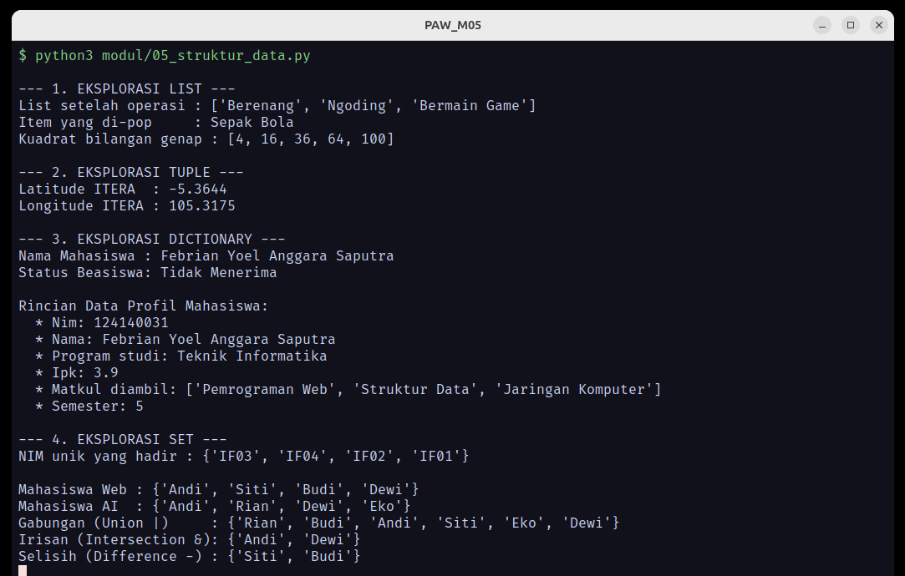
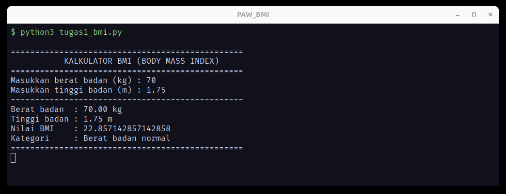
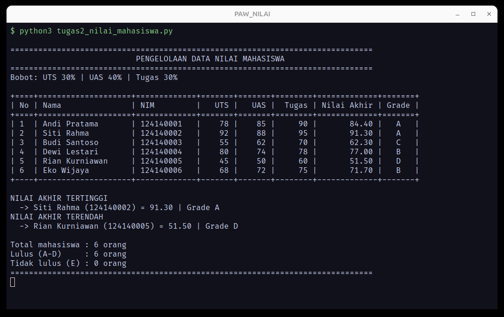
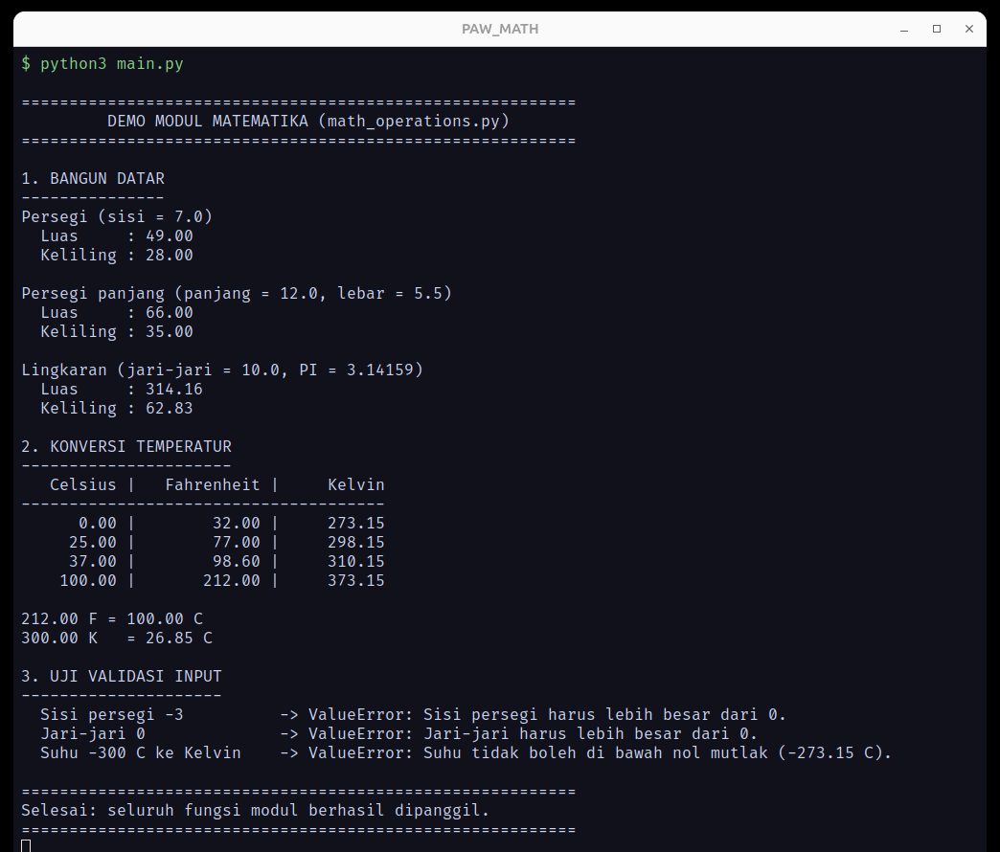

# Praktikum Pengembangan Aplikasi Web — Pertemuan 4: Python Dasar

**Program Studi Teknik Informatika — Institut Teknologi Sumatera (ITERA)**
Tahun Ajaran 2026/2027 Ganjil

---

## Identitas Praktikan

| Keterangan | Isi |
| :--- | :--- |
| **Nama** | Febrian Yoel Anggara Saputra |
| **NIM** | 124140031 |
| **Kelas Praktikum** | RB |
| **Mata Kuliah** | Pengembangan Aplikasi Web (PAW) |
| **Pertemuan** | 4 — Python Dasar |

---

## 1. Ringkasan Pekerjaan

Folder ini berisi seluruh hasil praktikum Pertemuan 4, terdiri dari:

1. **Enam modul praktikum** (`modul/01` – `modul/06`) beserta modul pendukung `kalkulator_lib.py`.
2. **Enam latihan mandiri** pada setiap akhir sub-bab (`modul/latihan1` – `modul/latihan5`, serta `password_gen.py` + `main.py`).
3. **Tiga tugas praktikum** pada folder utama:
   - `tugas1_bmi.py` — penghitung BMI.
   - `tugas2_nilai_mahasiswa.py` — pengelolaan nilai mahasiswa.
   - `math_operations.py` + `main.py` — modul matematika dan program pemanggilnya.

Seluruh berkas sudah dijalankan dan diuji pada **Python 3.12.3** (kompatibel Python 3.8+).

---

## 2. Struktur Folder

```text
febrianyoelanggarasaputra_124140031_pertemuan4/
├── .gitignore
├── README.md
├── tugas1_bmi.py                  # Tugas 1 — BMI
├── tugas2_nilai_mahasiswa.py      # Tugas 2 — nilai mahasiswa
├── math_operations.py             # Tugas 3 — modul matematika
├── main.py                        # Tugas 3 — program utama
├── docs/                          # Screenshot hasil eksekusi
│   ├── tugas1_bmi.png
│   ├── tugas2_nilai_mahasiswa.png
│   ├── tugas3_main_math_operations.png
│   ├── modul-01-pengenalan.png
│   ├── modul-02-variabel.png
│   ├── modul-03-kendali.png
│   ├── modul-04-fungsi.png
│   ├── modul-05-struktur-data.png
│   ├── modul-06-modul-app.png
│   ├── latihan-1-identitas.png
│   ├── latihan-2-suhu.png
│   ├── latihan-4-validasi-password.png
│   └── latihan-6-password-gen.png
└── modul/                         # Modul praktikum + latihan mandiri
    ├── 01_pengenalan.py
    ├── 02_variabel.py
    ├── 03_kendali.py
    ├── 04_fungsi.py
    ├── 05_struktur_data.py
    ├── 06_modul_app.py
    ├── kalkulator_lib.py
    ├── latihan1.py
    ├── latihan2_suhu.py
    ├── latihan3_tebak.py
    ├── latihan4_validasi.py
    ├── latihan5_kontak.py
    ├── password_gen.py
    └── main.py
```

> Catatan: ada dua berkas bernama `main.py`. Yang di folder utama adalah program
> Tugas 3 (`math_operations`), sedangkan `modul/main.py` adalah penguji modul
> `password_gen.py` pada latihan sub-bab 6. Keduanya berada di direktori berbeda
> sehingga tidak saling menimpa.

---

## 3. Modul Praktikum

| No | Berkas | Materi | Cara Menjalankan |
| :-- | :--- | :--- | :--- |
| 1 | `modul/01_pengenalan.py` | Sintaks dasar, `print()`, `sep`, `end`, escape character | `python modul/01_pengenalan.py` |
| 2 | `modul/02_variabel.py` | Variabel, tipe data, f-string, slicing string, casting, `input()` | `python modul/02_variabel.py` |
| 3 | `modul/03_kendali.py` | `if/elif/else`, ternary, `for`, `while`, `break`, `continue`, nested loop | `python modul/03_kendali.py` |
| 4 | `modul/04_fungsi.py` | `def`, docstring, default parameter, `*args`, `**kwargs`, multiple return, lambda | `python modul/04_fungsi.py` |
| 5 | `modul/05_struktur_data.py` | List, list comprehension, tuple, dictionary, set | `python modul/05_struktur_data.py` |
| 6 | `modul/06_modul_app.py` | Standard library (`math`, `random`, `datetime`) + modul kustom | `python modul/06_modul_app.py` |

Modul kustom `kalkulator_lib.py` berisi fungsi `tambah()`, `kurang()`, `kali()`,
dan `bagi()` dengan penjagaan pembagian nol. Blok `if __name__ == "__main__":`
hanya aktif saat modul dijalankan langsung, sehingga kode uji tidak ikut
tereksekusi ketika modul diimpor.

### Latihan Mandiri Modul

| Latihan | Berkas | Ringkasan |
| :--- | :--- | :--- |
| 1 | `modul/latihan1.py` | Kartu identitas dengan bingkai `#`, parameter `sep=" \| "`, dan escape `\t` / `\n`. |
| 2 | `modul/latihan2_suhu.py` | Konversi Celsius ke Fahrenheit dan Kelvin, hasil 2 angka desimal. |
| 3 | `modul/latihan3_tebak.py` | Game tebak angka 1–20 dengan `while`, umpan balik, dan `break`. |
| 4 | `modul/latihan4_validasi.py` | `validasi_password()`: minimal 8 karakter dan mengandung angka. |
| 5 | `modul/latihan5_kontak.py` | Katalog kontak berbasis dictionary: tambah, cari dengan `.get()`, tampilkan. |
| 6 | `modul/password_gen.py` + `modul/main.py` | Generator password acak (`random` + `string`) beserta program pengujinya. |

Contoh eksekusi modul:



---

## 4. Tugas 1 — Program Penghitung BMI

**Berkas:** `tugas1_bmi.py`

### Alur kerja

1. Program menampilkan judul, lalu meminta **berat badan (kg)** dan **tinggi badan (m)**.
2. `baca_angka()` memvalidasi masukan: nilai non-angka atau ≤ 0 akan ditolak dan
   pengguna diminta mengulang, sehingga program tidak *crash*. Tinggi badan juga
   divalidasi agar diisi dalam **meter** (mis. `1.70`, bukan `170`); nilai di atas
   3 m ditolak dengan pesan koreksi supaya BMI tidak salah tampil `0.00`.
3. `hitung_bmi()` menghitung `BMI = berat / (tinggi * tinggi)`.
4. `kategori_bmi()` menentukan kategori dengan `if-elif-else`:
   - `BMI < 18.5` → Berat badan kurang
   - `18.5 ≤ BMI < 25` → Berat badan normal
   - `25 ≤ BMI < 30` → Berat badan berlebih
   - `BMI ≥ 30` → Obesitas
5. Nilai BMI dicetak **apa adanya tanpa pembulatan** (`{bmi}`) bersama kategorinya,
   sehingga presisi hasil perhitungan tetap terlihat.

### Cara menjalankan

```bash
cd febrianyoelanggarasaputra_124140031_pertemuan4
python tugas1_bmi.py
```

### Bukti eksekusi



---

## 5. Tugas 2 — Pengelolaan Data Nilai Mahasiswa

**Berkas:** `tugas2_nilai_mahasiswa.py`

### Alur kerja

1. `DATA_MAHASISWA` menyimpan **6 dictionary** mahasiswa dengan kunci `nama`,
   `nim`, `nilai_uts`, `nilai_uas`, dan `nilai_tugas`.
2. `hitung_nilai_akhir()` menerapkan bobot **30% UTS + 40% UAS + 30% Tugas**.
3. `tentukan_grade()` memetakan nilai akhir ke grade:
   - **A** ≥ 80, **B** 70–79, **C** 60–69, **D** 50–59, **E** < 50.
4. `olah_data()` menyalin data dan menambahkan `nilai_akhir` serta `grade`
   tanpa mengubah data mentah.
5. `cetak_tabel()` mencetak tabel rata memakai f-string (`:<`, `:>`, `:^`) dengan
   lebar kolom tetap, sehingga tabel tetap rapi meski isi kolom berbeda panjang.
6. `cari_ekstrem()` mencari nilai akhir tertinggi dan terendah memakai `max()`
   dan `min()`, lalu mengembalikan **daftar** mahasiswa agar nilai seri tetap
   tertangani dengan benar.
7. Program menutup laporan dengan rekap jumlah mahasiswa lulus dan tidak lulus.

### Cara menjalankan

```bash
python tugas2_nilai_mahasiswa.py
```

### Bukti eksekusi



---

## 6. Tugas 3 — Modul Matematika dan Program Penggunaannya

**Berkas:** `math_operations.py` (modul) dan `main.py` (program utama).

### Isi modul `math_operations.py`

| Bagian | Fungsi |
| :--- | :--- |
| Konstanta | `PI = 3.14159` |
| Persegi | `luas_persegi(sisi)`, `keliling_persegi(sisi)` |
| Persegi panjang | `luas_persegi_panjang(panjang, lebar)`, `keliling_persegi_panjang(panjang, lebar)` |
| Lingkaran | `luas_lingkaran(jari_jari)`, `keliling_lingkaran(jari_jari)` |
| Temperatur | `celsius_ke_fahrenheit(c)`, `celsius_ke_kelvin(c)`, `fahrenheit_ke_celsius(f)`, `kelvin_ke_celsius(k)` |
| Tambahan | `akar_kuadrat(angka)` memakai `math.sqrt()` |

Setiap fungsi memiliki docstring yang menjelaskan parameter, nilai kembalian,
dan `ValueError` untuk masukan tidak valid (sisi negatif, jari-jari nol, suhu
di bawah nol mutlak).

### Dua cara impor pada `main.py`

```python
# Cara 1 — impor modul utuh dengan alias
import math_operations as mo
print(mo.luas_persegi(7))

# Cara 2 — impor fungsi dan konstanta secara langsung
from math_operations import celsius_ke_fahrenheit, celsius_ke_kelvin, PI
print(celsius_ke_fahrenheit(25))
```

`main.py` memanggil **seluruh fungsi** modul: luas dan keliling tiga bangun
datar, tabel konversi empat suhu, konversi balik Fahrenheit/Kelvin, serta blok
uji validasi yang menangkap `ValueError` dengan `try-except`.

### Cara menjalankan

```bash
python main.py
```

### Bukti eksekusi



---

## 7. Cara Menjalankan Seluruh Berkas

Jalankan perintah dari dalam folder `febrianyoelanggarasaputra_124140031_pertemuan4`.
Jika perintah `python` tidak dikenali, ganti dengan `python3`.

```bash
# Tugas
python tugas1_bmi.py
python tugas2_nilai_mahasiswa.py
python main.py

# Modul praktikum
python modul/01_pengenalan.py
python modul/02_variabel.py
python modul/03_kendali.py
python modul/04_fungsi.py
python modul/05_struktur_data.py
python modul/06_modul_app.py

# Latihan mandiri
python modul/latihan1.py
python modul/latihan2_suhu.py
python modul/latihan3_tebak.py
python modul/latihan4_validasi.py
python modul/latihan5_kontak.py

# Latihan modul kustom (harus dari dalam folder modul)
cd modul
python main.py
python password_gen.py
```

### Virtual environment (opsional)

```bash
python -m venv venv
source venv/bin/activate      # Linux / macOS
# .\venv\Scripts\activate     # Windows

pip freeze > requirements.txt
```

Folder `venv/` dan `__pycache__/` sudah dikecualikan melalui `.gitignore`
sehingga tidak ikut masuk ke repositori.

---

## 8. Catatan Implementasi

- Seluruh berkas lolos pemeriksaan sintaks dengan `python -m py_compile`.
- Kode mengikuti **PEP 8**: indentasi 4 spasi, nama variabel dan fungsi
  `snake_case`, serta penamaan konstanta `UPPER_CASE` (`PI`, `BOBOT_UTS`, dst.).
- Setiap fungsi memiliki **docstring** berisi deskripsi, parameter, dan nilai
  kembalian.
- Masukan pengguna divalidasi agar program tidak berhenti karena `ValueError`
  saat pengguna salah mengetik.
- Program yang membutuhkan `input()` dapat dijalankan langsung di terminal
  VS Code; tidak ada dependensi pihak ketiga yang perlu dipasang.
