# Praktikum Pengembangan Aplikasi Web — Pertemuan 5: Python OOP

**Program Studi Teknik Informatika — Institut Teknologi Sumatera (ITERA)**  
Tahun Ajaran 2026/2027 Ganjil

---

## Identitas Praktikan

| Keterangan | Isi |
| :--- | :--- |
| **Nama** | Febrian Yoel Anggara Saputra |
| **NIM** | 124140031 |
| **Kelas Praktikum** | RB |
| **Mata Kuliah** | Pengembangan Aplikasi Web (PAW) |
| **Pertemuan** | 5 — Pemrograman Berorientasi Objek (Python OOP) |

---

## 1. Ringkasan Pekerjaan

Repositori ini memuat seluruh hasil pengerjaan praktikum Pertemuan 5 mengenai **Pemrograman Berorientasi Objek (Object-Oriented Programming / OOP) dengan Python**, yang mencakup implementasi pilar utama OOP: *Class & Object*, *Inheritance*, *Encapsulation*, *Polymorphism*, serta *Abstract Base Class (ABC)*.

Pekerjaan yang telah diselesaikan terdiri dari:
1. **Tujuh Hands-on Modul Praktikum** (`latihan/01_everything_is_object.py` hingga `latihan/06_abstract_class.py`).
2. **Enam Latihan Mandiri Sub-bab** (`latihan/latihan_entitas_toko.py`, `latihan/latihan_buku.py`, `latihan/latihan_truk.py`, `latihan/latihan_karyawan.py`, `latihan/latihan_notifikasi.py`, dan `latihan/latihan_storage.py`).
3. **Tugas Praktikum Mandiri: Sistem Manajemen Perpustakaan Berbasis OOP** yang terorganisir ke dalam arsitektur modular yang rapi di folder `tugas_perpustakaan/`:
   - `library_item.py`: Abstract class `LibraryItem(ABC)` beserta 3 subclass konkrit (`Book`, `Magazine`, dan bonus `DigitalMedia`).
   - `member.py`: Class `Member` dengan enkapsulasi data keanggotaan dan kuota pinjaman.
   - `library.py`: Class `Library` yang mengelola katalog item, anggota, transaksi peminjaman/pengembalian, serta denda polimorfik.
   - `main.py`: Skrip pengujian otomatis komprehensif 10 skenario sekaligus menyediakan menu CLI interaktif.
4. **Dokumentasi Lengkap & Screenshot Terminal** pada direktori `docs/` sebanyak 18 berkas tangkapan layar beresolusi tinggi.

Seluruh kode program telah diuji coba dan dieksekusi dengan sukses pada **Python 3.12.3** (kompatibel penuh dengan Python 3.8+).

---

## 2. Struktur Folder

```text
febrianyoelanggarasaputra_124140031_pertemuan5/
├── .gitignore                     # Aturan pengabaian cache (__pycache__/) & virtual environment (venv/)
├── README.md                      # Laporan komprehensif praktikum dan panduan eksekusi
├── docs/                          # Bukti tangkapan layar (screenshot) hasil eksekusi terminal
│   ├── modul-01-everything-is-object.png
│   ├── modul-01-procedural-vs-oop.png
│   ├── modul-02-class-object.png
│   ├── modul-03-inheritance.png
│   ├── modul-04-encapsulation.png
│   ├── modul-05-polymorphism.png
│   ├── modul-06-abstract-class.png
│   ├── latihan-1-entitas-toko.png
│   ├── latihan-2-buku.png
│   ├── latihan-3-truk.png
│   ├── latihan-4-karyawan.png
│   ├── latihan-5-notifikasi.png
│   ├── latihan-6-storage.png
│   ├── tugas-perpustakaan-demo-lengkap.png
│   ├── tugas-perpustakaan-katalog.png
│   ├── tugas-perpustakaan-pencarian.png
│   ├── tugas-perpustakaan-peminjaman.png
│   └── tugas-perpustakaan-pengembalian-denda.png
├── latihan/                       # Berkas modul praktikum & latihan mandiri sub-bab
│   ├── 01_everything_is_object.py
│   ├── 01_procedural_vs_oop.py
│   ├── 02_class_object.py
│   ├── 03_inheritance.py
│   ├── 04_encapsulation.py
│   ├── 05_polymorphism.py
│   ├── 06_abstract_class.py
│   ├── latihan_entitas_toko.py   # Latihan Mandiri 1: Pemodelan Toko Kasir
│   ├── latihan_buku.py           # Latihan Mandiri 2: Class Buku & Dunder Length
│   ├── latihan_truk.py           # Latihan Mandiri 3: Truk Ekspedisi (Inheritance)
│   ├── latihan_karyawan.py       # Latihan Mandiri 4: Enkapsulasi Gaji UMR (@property)
│   ├── latihan_notifikasi.py     # Latihan Mandiri 5: Dispatcher Multi-Saluran (Duck Typing)
│   └── latihan_storage.py        # Latihan Mandiri 6: Interface File Storage (ABC)
└── tugas_perpustakaan/            # Arsitektur Berkas Tugas Praktikum
    ├── library_item.py           # Abstract Base Class LibraryItem, Book, Magazine, DigitalMedia
    ├── member.py                 # Class Member (Anggota & Kuota Pinjaman)
    ├── library.py                # Class Library (Katalog, Transaksi, Denda Polimorfik)
    └── main.py                   # Program Utama Pengujian Otomatis & Menu CLI
```

---

## 3. Pembahasan Modul Hands-On Praktikum

### Ringkasan Berkas Modul
| No | Berkas | Materi Pokok | Perintah Eksekusi |
| :-- | :--- | :--- | :--- |
| 1 | `latihan/01_everything_is_object.py` | Eksplorasi filosofi *Everything is an Object*, `type()`, `id()`, dan method tipe bawaan | `python3 latihan/01_everything_is_object.py` |
| 2 | `latihan/01_procedural_vs_oop.py` | Studi komparasi praktis paradigma Prosedural vs Object-Oriented | `python3 latihan/01_procedural_vs_oop.py` |
| 3 | `latihan/02_class_object.py` | Class, Instance, Constructor `__init__`, Class Attribute, dan Dunder (`__str__`, `__repr__`) | `python3 latihan/02_class_object.py` |
| 4 | `latihan/03_inheritance.py` | Superclass, Single/Multiple Inheritance, fungsi `super()`, Method Overriding, dan MRO | `python3 latihan/03_inheritance.py` |
| 5 | `latihan/04_encapsulation.py` | Access Modifiers (Public, Protected `_`, Private `__`), Name Mangling, `@property` Getter & Setter | `python3 latihan/04_encapsulation.py` |
| 6 | `latihan/05_polymorphism.py` | Polymorphism via Inheritance, Duck Typing, Dispatch Loop, dan Operator Overloading (`__add__`, `__eq__`) | `python3 latihan/05_polymorphism.py` |
| 7 | `latihan/06_abstract_class.py` | Modul `abc`, class `ABC`, `@abstractmethod`, Interface Pattern, dan Enforcement Penolakan Instansiasi | `python3 latihan/06_abstract_class.py` |

---

### Rincian Modul & Bukti Eksekusi

#### Modul 1: Filosofi "Everything is an Object" & Perbandingan Paradigma
- **Hands-on 1 (`01_everything_is_object.py`):** Membuktikan bahwa tipe data primitif (`int`, `str`, `list`), bahkan fungsi sekali pun, merupakan objek tingkat pertama (*first-class object*) yang memiliki atribut kelas (`__class__`), method internal, dan identitas memori unik (`id()`).
  
  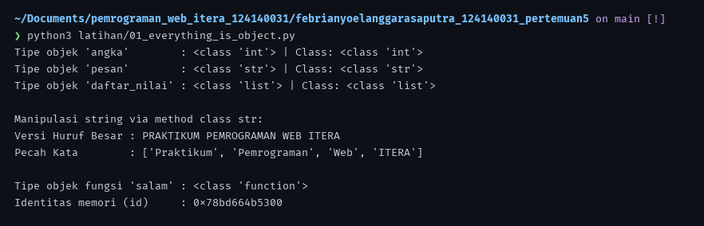

- **Hands-on 2 (`01_procedural_vs_oop.py`):** Mendemonstrasikan kerapuhan pendekatan prosedural di mana data dictionary dan fungsi pemrosesan terpisah tanpa perlindungan validasi, dibandingkan dengan pendekatan OOP di mana data dan method menyatu dalam class `Mahasiswa`.

  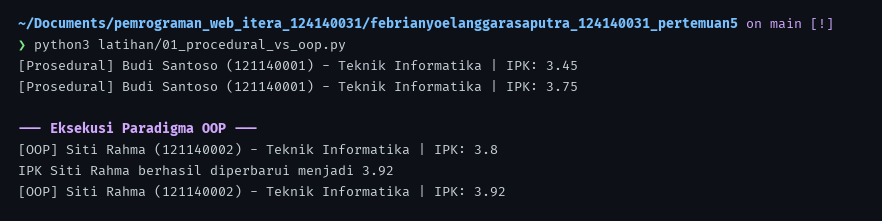

#### Modul 2: Class & Object (`02_class_object.py`)
Membangun class `Mahasiswa` dengan atribut tingkat class (`universitas`, `total_mahasiswa_terdaftar`), atribut instance (`nama`, `nim`, `ipk`, `daftar_matkul`), metode instance (`tambah_matkul()`, `evaluasi_status()`), serta dunder methods `__str__` dan `__repr__`.

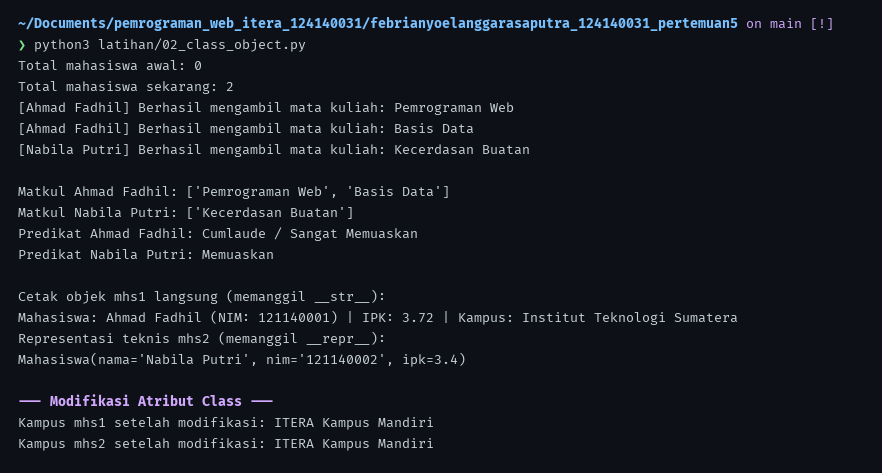

#### Modul 3: Inheritance & Method Overriding (`03_inheritance.py`)
Menerapkan hierarki pewarisan dari base class `Kendaraan` ke subclass `Mobil` dan `Motor`. Dilanjutkan dengan demonstrasi multiple inheritance pada `MobilListrik` yang mewarisi `Mobil` dan `KomponenBaterai`, lengkap dengan pengujian Method Resolution Order (`__mro__`), `isinstance()`, dan `issubclass()`.

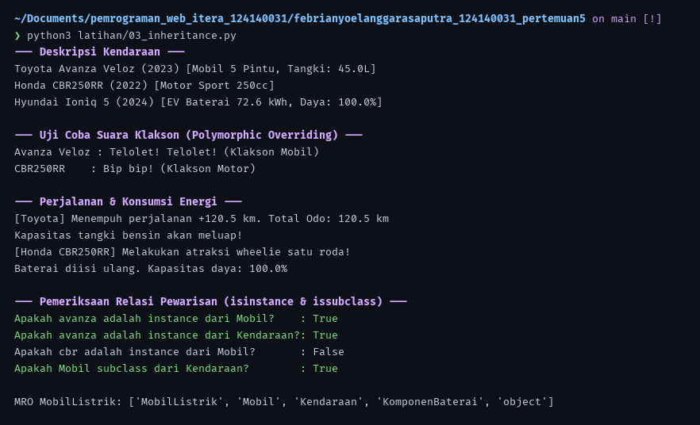

#### Modul 4: Encapsulation & Properties (`04_encapsulation.py`)
Membangun sistem keamanan `RekeningBank` dengan 3 tingkat akses:
1. **Public:** `nomor_rekening` (bebas diakses).
2. **Protected (`_`):** `_pemilik`, `_riwayat_transaksi` (konvensi internal).
3. **Private (`__`):** `__saldo`, `__pin` (terlindungi mekanisme *name mangling* Python `_RekeningBank__saldo`).
Akses saldo dikendalikan secara elegan menggunakan dekorator `@property` getter dan setter dengan validasi numerik non-negatif.

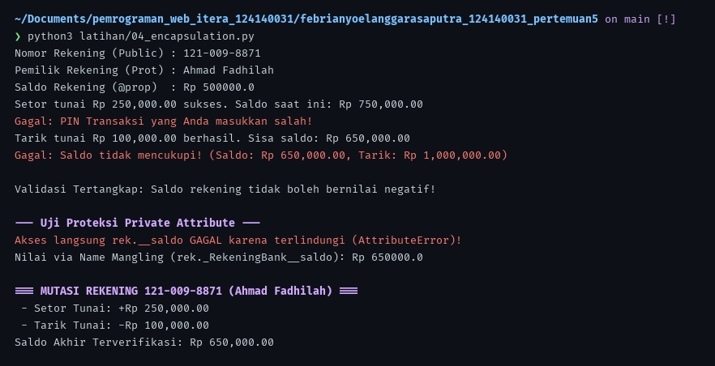

#### Modul 5: Polymorphism & Overriding (`05_polymorphism.py`)
Mengimplementasikan gateway pembayaran heterogen:
- Polimorfisme via pewarisan: `TransferBank` dan `EWallet` meng-override method `bayar()` milik `MetodePembayaran`.
- *Duck Typing*: Class `CryptoPayment` yang berdiri sendiri tanpa mewarisi class induk tetap dapat diproses dalam fungsi `proses_checkout_pesanan()` karena memiliki method `bayar()` yang kompatibel.
- *Operator Overloading*: Meng-override dunder method `__add__` dan `__eq__` pada class `Dompet` sehingga objek dompet dapat dijumlahkan secara langsung (`d1 + d2`).

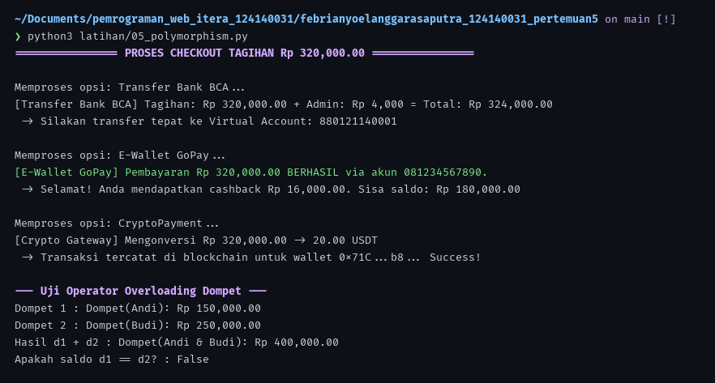

#### Modul 6: Abstract Class & Interface (`06_abstract_class.py`)
Menerapkan modul bawaan `abc` (`ABC` dan `@abstractmethod`) pada class `Shape` (`luas()`, `keliling()`) dan konektor database backend `DatabaseConnector` (`connect()`, `execute_query()`, `disconnect()`). Modul ini membuktikan bahwa Python menolak instansiasi langsung dari abstract class maupun subclass yang lupa mengimplementasikan abstract method.

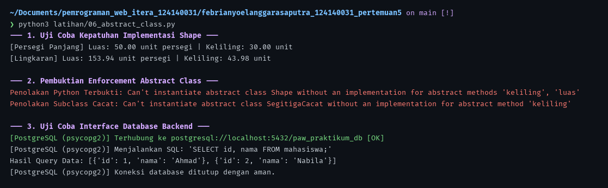

---

## 4. Pembahasan Latihan Mandiri Sub-bab

### Ringkasan Latihan Mandiri
| Latihan | Berkas | Konsep OOP | Deskripsi Singkat |
| :--- | :--- | :--- | :--- |
| 1 | `latihan/latihan_entitas_toko.py` | Pemodelan Entitas Nyata | Class `Produk`, `Keranjang`, dan `Pengguna` dengan interaksi pemotongan stok, kalkulasi subtotal, dan checkout dompet digital. |
| 2 | `latihan/latihan_buku.py` | Special (Dunder) Methods | Class `Buku` dengan perhitungan diskon persentase, kartu buku `__str__`, dan dunder method `__len__` yang mengembalikan jumlah halaman. |
| 3 | `latihan/latihan_truk.py` | Subclassing & Overriding | Subclass `Truk(Kendaraan)` dengan atribut muatan logistik, validasi muatan berlebih (*overload*), dan method overriding `deskripsi()`. |
| 4 | `latihan/latihan_karyawan.py` | Property Decorator & Enkapsulasi | Class `Karyawan` dengan atribut private `__gaji_pokok`, validasi batas bawah UMR (Rp 3.200.000) via `@property` setter, serta slip gaji bersih. |
| 5 | `latihan/latihan_notifikasi.py` | Duck Typing & Dispatcher | Tiga class kanal notifikasi terpisah (`NotifikasiEmail`, `NotifikasiSMS`, `NotifikasiWhatsApp`) dan fungsi polimorfik `broadcast_pengumuman()`. |
| 6 | `latihan/latihan_storage.py` | Abstract Base Class & Interface | Abstract class `FileStorage(ABC)` dengan method abstrak `upload_file()` dan `download_file()`, diimplementasikan pada `LocalDiskStorage` dan `CloudStorage`. |

---

### Rincian & Bukti Eksekusi Latihan Mandiri

#### Latihan Mandiri 1: Pemodelan Entitas Sistem Kasir Toko Online (`latihan_entitas_toko.py`)
- **Tujuan:** Memodelkan entitas bisnis toko online ke dalam class terstruktur.
- **Implementasi:**
  - `Produk`: memiliki atribut `kode_produk`, `nama_produk`, `harga`, `stok`, serta method `kurangi_stok()`, `tambah_stok()`, dan `hitung_subtotal()`.
  - `Keranjang`: mengelola kamus item belanja `{Produk: kuantitas}`, kalkulasi total belanjaan, dan pencetakan struk.
  - `Pengguna`: mengelola identitas pembeli, deposit saldo dompet, dan proses finalisasi `checkout()` dengan validasi kecukupan dana.

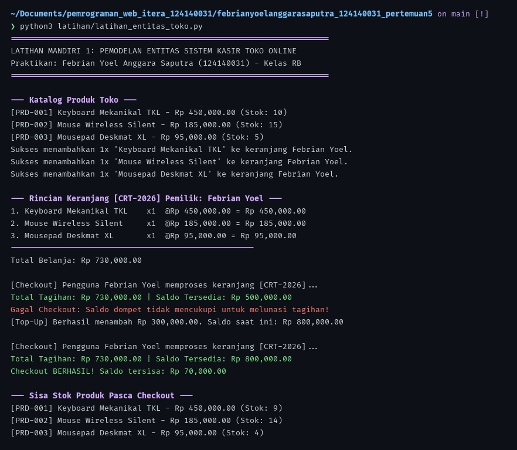

#### Latihan Mandiri 2: Class Buku dengan Diskon & Dunder Length (`latihan_buku.py`)
- **Tujuan:** Mengimplementasikan class literatur dengan dunder method bawaan Python.
- **Implementasi:**
  - Method `hitung_harga_diskon(persen)`: menghitung harga bersih setelah potongan diskon.
  - Method `__str__`: mencetak kartu informasi buku dengan bingkai tabel ASCII yang rapi.
  - Method `__len__`: mengembalikan atribut `jumlah_halaman` saat fungsi bawaan `len(buku)` dipanggil.

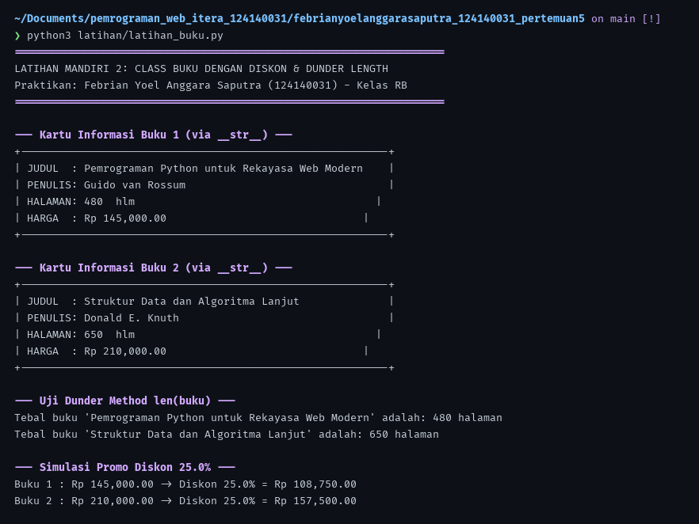

#### Latihan Mandiri 3: Armada Truk Ekspedisi Kargo (`latihan_truk.py`)
- **Tujuan:** Mewarisi class `Kendaraan` dan menambahkan kontrol muatan logistik.
- **Implementasi:**
  - Subclass `Truk(Kendaraan)` menambahkan `kapasitas_maksimal_ton` dan `muatan_saat_ini`.
  - Method `muat_barang(berat_ton)`: memvalidasi agar muatan tidak melampaui kapasitas maksimal truk (mencegah *overload*).
  - Method overriding `deskripsi()`: memperkaya informasi kendaraan dengan kapasitas dan persentase utilisasi muatan kargo.

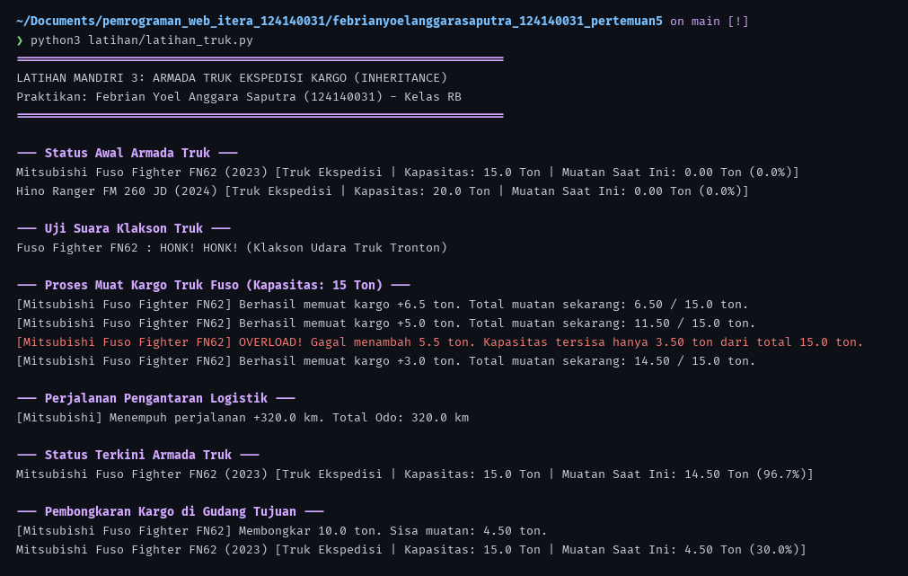

#### Latihan Mandiri 4: Enkapsulasi Penggajian Karyawan (`latihan_karyawan.py`)
- **Tujuan:** Melindungi data penggajian menggunakan enkapsulasi dan aturan bisnis Upah Minimum Regional (UMR).
- **Implementasi:**
  - Atribut publik: `nama` dan `jabatan`.
  - Atribut private: `__gaji_pokok` (dilindungi *name mangling*).
  - Dekorator `@property` getter dan setter: melempar `ValueError` apabila ada upaya menetapkan gaji pokok di bawah batas minimum UMR (Rp 3.200.000).
  - Method `hitung_gaji_bersih(pajak_persen)` dan `cetak_slip_gaji()`: mencetak rincian take-home-pay setelah dipotong pajak PPh.

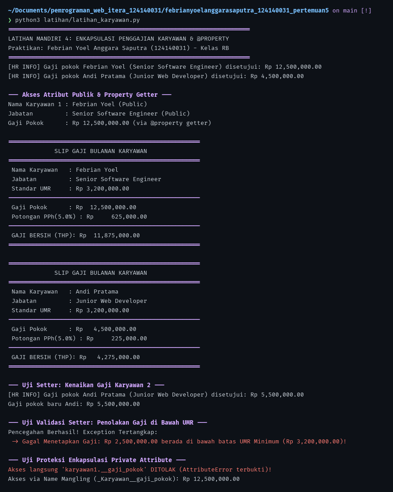

#### Latihan Mandiri 5: Engine Dispatcher Multi-Saluran Notifikasi (`latihan_notifikasi.py`)
- **Tujuan:** Menerapkan polimorfisme berbasis *Duck Typing* tanpa keterikatan hierarki pewarisan langsung.
- **Implementasi:**
  - Class `NotifikasiEmail`, `NotifikasiSMS`, dan `NotifikasiWhatsApp` masing-masing mengimplementasikan kontrak method `kirim(pesan, penerima)`.
  - Fungsi `broadcast_pengumuman(daftar_channel, pesan)`: mendistribusikan pesan darurat ke seluruh kanal heterogen secara serentak tanpa perlu memeriksa tipe class melalui percabangan `if/elif`.

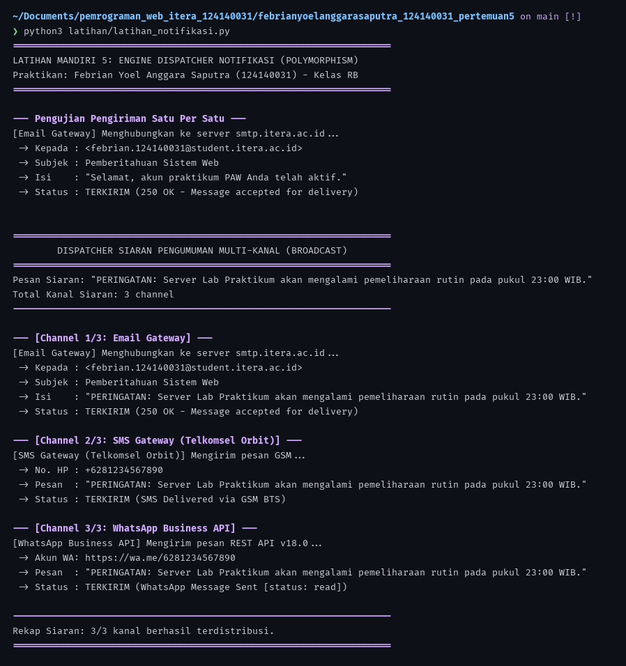

#### Latihan Mandiri 6: Interface File Storage Service (`latihan_storage.py`)
- **Tujuan:** Merancang kontrak abstraksi penyimpanan berkas menggunakan Abstract Base Class (`ABC`).
- **Implementasi:**
  - Abstract class `FileStorage(ABC)` dengan dua abstract method: `upload_file(nama_file, data_bytes)` dan `download_file(nama_file)`.
  - Class konkrit `LocalDiskStorage`: mensimulasikan penyimpanan berkas ke direktori server lokal.
  - Class konkrit `CloudStorage`: mensimulasikan unggahan berkas ke Google Cloud Storage (GCS) bucket dengan URI `gs://`.
  - Menunjukkan penolakan Python ketika mencoba menginstansiasi class abstrak secara langsung.

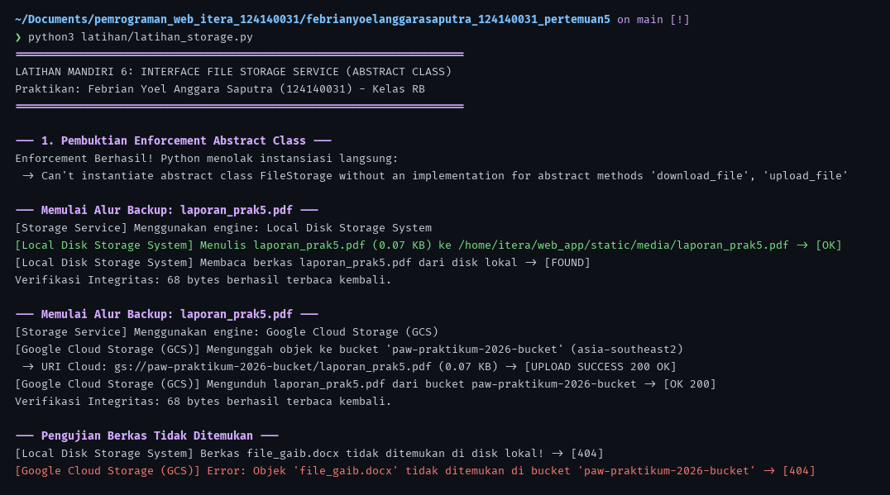

---

## 5. Pembahasan Tugas Praktikum: Sistem Manajemen Perpustakaan Berbasis OOP

### Deskripsi & Arsitektur Sistem
Tugas praktikum ini mengimplementasikan **Sistem Manajemen Perpustakaan Terpadu** yang memodelkan operasional peminjaman, pengembalian, pencarian katalog, manajemen anggota, dan audit transaksi menggunakan arsitektur modular:

```text
tugas_perpustakaan/
├── library_item.py    # Abstraksi koleksi perpustakaan & ragam jenis item
├── member.py          # Entitas anggota perpustakaan & proteksi kuota pinjaman
├── library.py         # Pusat manajemen perpustakaan, katalog, transaksi, dan audit log
└── main.py            # Skrip demonstrasi pengujian otomatis & antarmuka CLI interaktif
```

---

### Penerapan Empat Pilar Utama OOP

#### 1. Abstraction (Abstraksi)
- Diwujudkan melalui abstract base class `LibraryItem(ABC)` di dalam `library_item.py`.
- Class ini menetapkan kontrak antarmuka formal yang wajib dipenuhi oleh seluruh jenis koleksi perpustakaan melalui dekorator `@abstractmethod`:
  - `get_detail() -> str`: menghasilkan rincian spesifik item.
  - `hitung_denda(hari_terlambat: int) -> float`: menghitung tarif denda keterlambatan sesuai kebijakan masing-masing jenis koleksi.
  - `get_durasi_maksimal_pinjam() -> int`: menetapkan batas maksimal waktu pinjaman.
- Class `Library` dapat berinteraksi dengan koleksi apa pun secara konsisten tanpa perlu mengetahui detail internal teknis subclass.

#### 2. Inheritance (Pewarisan)
- Tiga subclass konkrit mewarisi sifat dasar dari `LibraryItem`:
  - `Book`: merepresentasikan buku fisik (menambahkan atribut `penulis`, `isbn`, `jumlah_halaman`, `genre`).
  - `Magazine`: merepresentasikan majalah/jurnal berkala (menambahkan atribut `edisi`, `penerbit`, `kategori`, `frekuensi_terbit`).
  - `DigitalMedia` *(Fitur Nilai Plus)*: merepresentasikan media digital seperti audiobook dan video e-learning (menambahkan atribut `format_media`, `ukuran_mb`, `durasi_menit`).
- Menggunakan fungsi bawaan `super().__init__(item_id, judul, tahun_terbit)` untuk menginisialisasi atribut induk secara terstruktur.

#### 3. Encapsulation (Enkapsulasi)
- **Tingkat Akses Protected (`_`):** Pada `LibraryItem`, atribut internal `_item_id`, `_judul`, `_tahun_terbit`, dan `_is_dipinjam` didefinisikan dengan prefix `_` agar dapat diakses oleh subclass namun terlindungi dari modifikasi langsung di luar class.
- **Tingkat Akses Private (`__`):**
  - Pada `Member`, atribut `__id_member`, `__nama`, `__email`, `__maks_pinjaman`, dan `__daftar_pinjaman` dilindungi penuh menggunakan *name mangling* (`_Member__daftar_pinjaman`) untuk menjamin integritas data anggota.
  - Pada `Library`, kamus `__koleksi`, `__daftar_member`, dan `__riwayat_transaksi` bersifat private sehingga tidak dapat dirusak secara sembarangan dari luar.
- **Dekorator `@property`:**
  - Digunakan untuk menyediakan antarmuka akses baca (*read-only*) pada atribut privat/protected.
  - Property setter `@is_dipinjam.setter` memvalidasi bahwa nilai status peminjaman harus berupa tipe data boolean murni (`bool`).

#### 4. Polymorphism (Polimorfisme)
- **Katalog Terpadu:** Method `Library.tampilkan_katalog()` memproses list heterogen berisi `Book`, `Magazine`, dan `DigitalMedia` dalam satu perulangan seragam dengan memanggil method `item.get_detail()`.
- **Perhitungan Denda Keterlambatan Polimorfik:** Saat pengembalian diproses melalui `Library.kembalikan_item()`, sistem memanggil `item.hitung_denda(hari_terlambat)`. Masing-masing subclass menghitung denda sesuai tarifnya sendiri secara otomatis tanpa percabangan manual:
  - `Book`: Rp 2.000 / hari keterlambatan.
  - `Magazine`: Rp 1.000 / hari keterlambatan.
  - `DigitalMedia`: Rp 3.000 / hari keterlambatan.

---

### Penjelasan Rinci Modul Tugas

#### Modul `library_item.py`
Mendefinisikan class abstrak `LibraryItem` dan ketiga implementasi konkritnya:
- Menyediakan property getter: `item_id`, `judul`, `tahun_terbit`, `is_dipinjam`, `peminjam_id`, dan `tipe_item`.
- Menyediakan property setter: `is_dipinjam` dengan validasi ketat.
- Menyediakan concrete methods: `tandai_dipinjam(member_id)` dan `tandai_dikembalikan()`.
- Dunder methods `__str__` dan `__repr__` untuk representasi yang informatif.

#### Modul `member.py`
Mendefinisikan entitas anggota perpustakaan `Member`:
- Membedakan kuota maksimal pinjaman berdasarkan kategori keanggotaan (Mahasiswa: 3 item, Dosen/Peneliti: 5 item).
- Method `bisa_pinjam()`: memvalidasi sisa kuota sebelum peminjaman disetujui.
- Method `tambah_pinjaman(item)` dan `kembalikan_pinjaman(item_id)`: mengelola mutasi item pada daftar pinjaman anggota.
- Dunder method `__len__` (mengembalikan jumlah pinjaman aktif) dan `__bool__` (menjamin evaluasi truthiness objek selalu `True`).

#### Modul `library.py`
Merupakan pusat pengendali (*controller*) sistem perpustakaan:
- `tambah_item(item)`: mendaftarkan item baru dengan validasi tipe `isinstance(item, LibraryItem)` dan verifikasi keunikan ID.
- `tambah_member(member)`: mendaftarkan anggota baru.
- `tampilkan_katalog(hanya_tersedia)`: menampilkan tabel katalog seluruh koleksi atau khusus item yang siap dipinjam.
- `cari_item_by_id(item_id)`: pencarian cepat instan berbasis kamus hash $O(1)$.
- `cari_item_by_judul(kata_kunci)`: pencarian koleksi berdasarkan potongan kata kunci judul (*case-insensitive*).
- `pinjam_item(item_id, id_member)`: orkestrasi peminjaman lengkap dengan validasi status ketersediaan item, validasi keanggotaan, pemeriksaan batas kuota, pencatatan peminjam, serta perekaman audit log.
- `kembalikan_item(item_id, id_member, hari_terlambat)`: orkestrasi pengembalian item, reset status ketersediaan, pembersihan daftar pinjaman anggota, perhitungan denda polimorfik, dan perekaman audit log.
- `tampilkan_statistik()` dan `tampilkan_audit_log()`: pelaporan metrik kinerja sistem dan rekap jejak transaksi.

#### Modul `main.py`
Menyediakan dua mode operasional:
1. **Mode Demonstrasi Otomatis (Default):** Mengeksekusi 10 skenario pengujian komprehensif mulai dari inisialisasi, registrasi katalog, pencarian, peminjaman, validasi kuota berlebih, pengembalian tepat waktu dan terlambat dengan denda polimorfik, pembuktian enkapsulasi name mangling, pembuktian penolakan instansiasi abstract class, hingga rekap statistik dan audit log.
2. **Mode Interaktif CLI (`--interactive` atau `-i`):** Antarmuka berbasis menu konsol (1-9) yang memungkinkan pengguna mencoba fitur secara langsung.

---

### Panduan Menjalankan Program Tugas

Pastikan berada pada direktori utama praktikum `febrianyoelanggarasaputra_124140031_pertemuan5/`:

```bash
# 1. Pindah ke direktori tugas praktikum
cd febrianyoelanggarasaputra_124140031_pertemuan5

# 2. Menjalankan skenario pengujian otomatis lengkap
python3 tugas_perpustakaan/main.py

# 3. Menjalankan dalam mode menu interaktif CLI
python3 tugas_perpustakaan/main.py --interactive
```

---

### Bukti Tangkapan Layar (Screenshot) Hasil Eksekusi Tugas

#### 1. Inisialisasi & Penampilan Seluruh Katalog Koleksi (Polymorphism)
Menampilkan katalog item perpustakaan yang memuat berbagai macam entitas (`Book`, `Magazine`, `DigitalMedia`) dalam satu tampilan tabel terpadu:

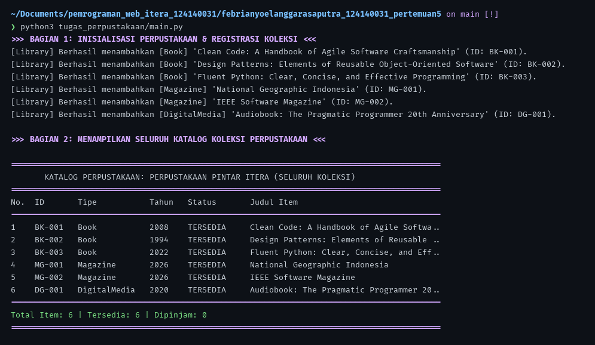

#### 2. Fitur Pencarian Item Berdasarkan ID & Kata Kunci Judul
Mencari item secara presisi berdasarkan identifier unik (`BK-002`) serta pencarian fleksibel berdasarkan kata kunci `"Python"` dan `"Software"`:

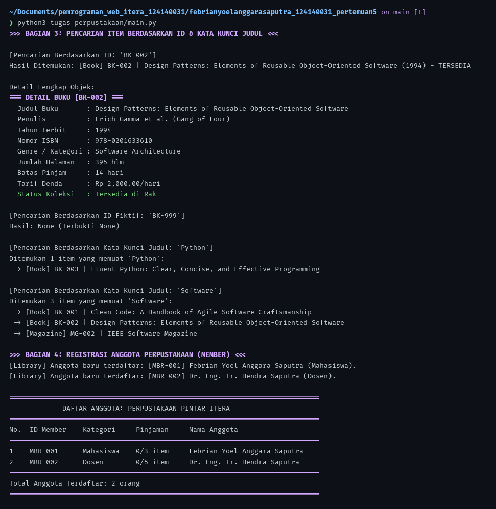

#### 3. Peminjaman Item & Validasi Kuota Anggota
Mendemonstrasikan transaksi peminjaman buku, majalah, dan media digital oleh anggota mahasiswa (`MBR-001`), penolakan pinjaman saat kuota 3 item telah penuh, serta peminjaman oleh dosen (`MBR-002`):

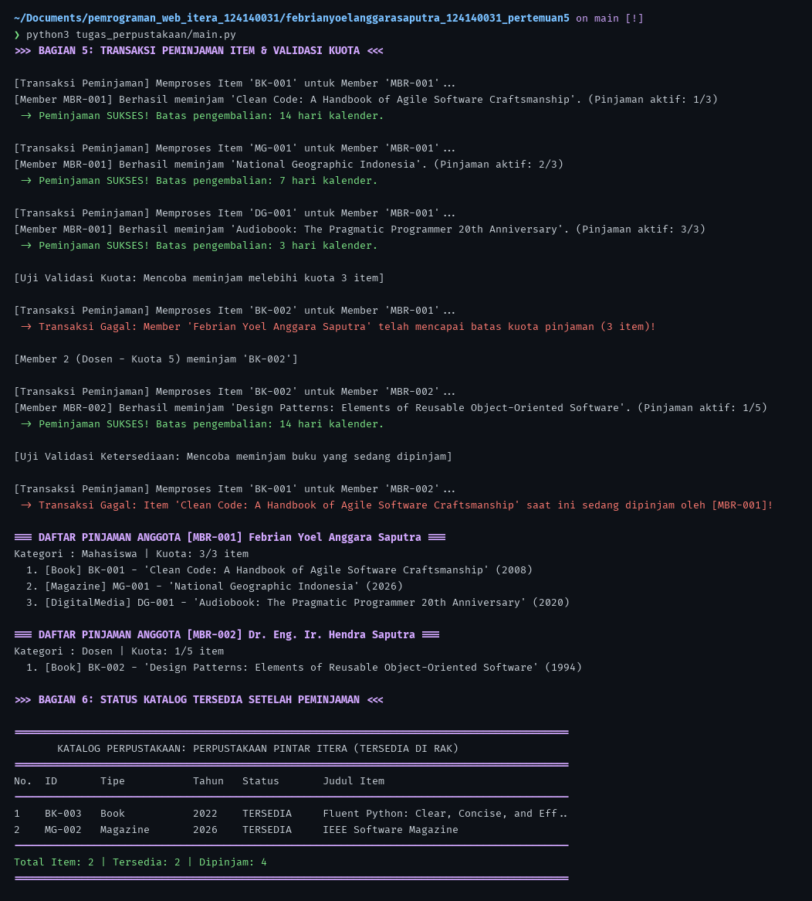

#### 4. Pengembalian Item, Perhitungan Denda Polimorfik & Uji Enkapsulasi
Mendemonstrasikan pengembalian item tepat waktu (denda Rp 0), pengembalian majalah terlambat 4 hari (denda Rp 4.000), pengembalian media digital terlambat 2 hari (denda Rp 6.000), pengembalian buku terlambat 5 hari (denda Rp 10.000), serta pembuktian proteksi atribut private dan abstract class:

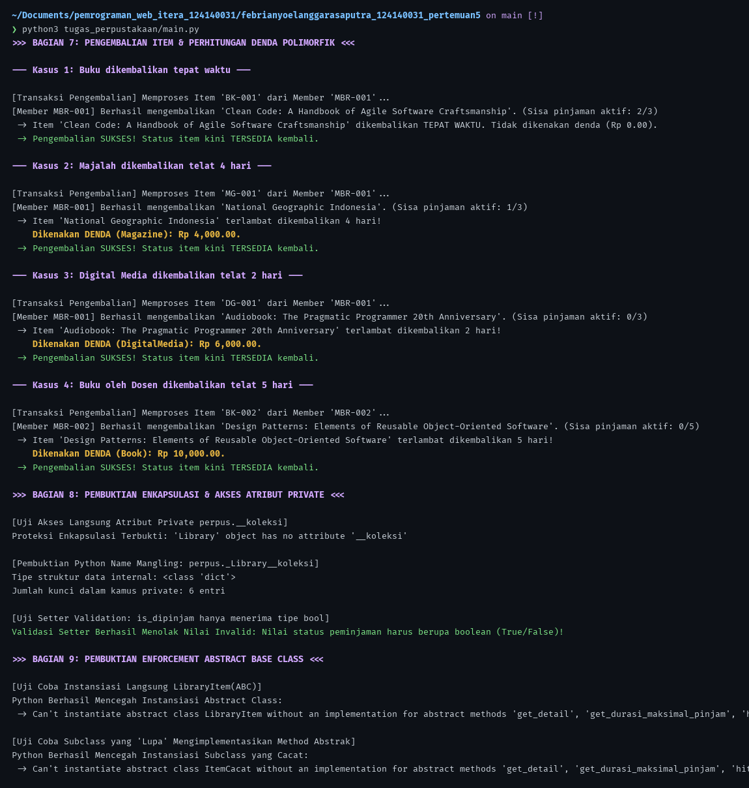

#### 5. Ringkasan Demonstrasi Lengkap Sistem Perpustakaan
Tangkapan layar hasil uji coba menyeluruh dari awal hingga akhir yang mencakup ringkasan statistik dan audit log riwayat transaksi:

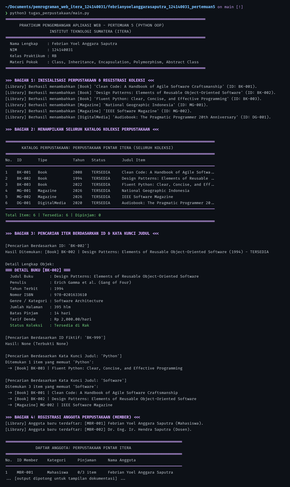

---

## 6. Kesimpulan & Refleksi Pembelajaran

Melalui praktikum Pertemuan 5 ini, beberapa kesimpulan krusial mengenai penerapan OOP di Python yang berhasil dipelajari dan diimplementasikan adalah:

1. **Paradigma Berorientasi Objek vs Prosedural:** OOP memberikan pemisahan tanggung jawab yang jelas (*separation of concerns*). Data tidak lagi dibiarkan mengambang bebas dalam variabel global atau dictionary bebas, melainkan diikat bersama metode perlakunya di dalam kelas sehingga integritas data senantiasa terjaga.
2. **Kekuatan Abstraksi dan Pewarisan:** Dengan mendefinisikan *Abstract Base Class* (`ABC`), kita membangun kontrak antarmuka yang baku. Subclass seperti `Book`, `Magazine`, dan `DigitalMedia` bebas memiliki perilaku khusus masing-masing namun tetap tunduk pada aturan umum yang seragam.
3. **Pentingnya Enkapsulasi & Data Protection:** Python menerapkan enkapsulasi melalui konvensi nama (`_` protected dan `__` private dengan mekanisme *name mangling*). Penggunaan dekorator `@property` getter dan setter terbukti sangat ampuh untuk memvalidasi nilai sebelum state objek diubah tanpa harus merusak antarmuka pemanggilan atribut.
4. **Fleksibilitas Polimorfisme:** Sistem perpustakaan mampu mengelola berbagai tipe objek secara seragam baik saat pencetakan katalog, peminjaman, maupun kalkulasi tarif denda keterlambatan yang disesuaikan secara dinamis menurut kelas objeknya.
5. **Kesiapan Pengembangan Aplikasi Web Skala Nyata:** Konsep-konsep OOP yang dipelajari pada modul ini merupakan pondasi fundamental dalam perancangan arsitektur backend modern, termasuk pola Model-View-Controller (MVC), Object-Relational Mapping (ORM), dan arsitektur repositori layanan pada framework web Python masa depan.

