# Praktikum Pengembangan Aplikasi Web - Pertemuan 6
## Implementasi RESTful API Berbasis Framework Pyramid, SQLAlchemy ORM, dan PostgreSQL

---

### Identitas Praktikan
* **Nama**: Febrian Yoel Anggara Saputra
* **NIM**: 124140031
* **Kelas**: RB
* **Program Studi**: Teknik Informatika
* **Institusi**: Institut Teknologi Sumatera (ITERA)

---

## 1. Deskripsi Proyek

Repository ini berisi implementasi aplikasi backend **RESTful API** menggunakan **Framework Pyramid** (Python Web Framework berbasis WSGI), **SQLAlchemy ORM**, **Alembic Database Migration**, dan basis data relasional **PostgreSQL**.

Aplikasi ini mencakup dua modul utama:
1. **Latihan Modul: RESTful API Manajemen Mahasiswa**
   * Pengelolaan data mahasiswa (`id`, `nim`, `nama`, `jurusan`, `tanggal_lahir`, `alamat`).
   * Operasi CRUD lengkap dengan validasi integritas data, keunikan NIM, dan penanganan format tanggal ISO.
2. **Tugas Praktikum: RESTful API Manajemen Matakuliah**
   * Pengelolaan data mata kuliah (`id`, `kode_mk`, `nama_mk`, `sks`, `semester`).
   * Operasi CRUD lengkap dengan predikat `request_method` pada rute routing.
   * Validasi ketat pada field wajib, keunikan `kode_mk`, serta verifikasi nilai numerik `sks` dan `semester` agar tidak bernilai negatif atau nol (mengembalikan status HTTP `400 Bad Request`).
   * Penanganan entitas tidak ditemukan dengan HTTP `404 Not Found`.

---

## 2. Struktur Direktori Proyek

```text
febrianyoelanggarasaputra_124140031_pertemuan6/
├── development.ini                      # Konfigurasi server lokal & database dev (PostgreSQL)
├── production.ini                       # Konfigurasi server production
├── setup.py                             # Metadata paket dan dependensi aplikasi Python
├── README.md                            # Dokumentasi teknis dan laporan pengujian
├── .gitignore                           # Filter pengecualian virtualenv, bytecode cache, sqlite
├── docs/                                # Direktori bukti tangkapan layar pengujian cURL
│   ├── 01_server_pserve.png
│   ├── 02_alembic_migration.png
│   ├── 03_mahasiswa_get_all.png
│   ├── 04_mahasiswa_get_detail.png
│   ├── 05_mahasiswa_post.png
│   ├── 06_mahasiswa_post_error_400.png
│   ├── 07_mahasiswa_put.png
│   ├── 08_mahasiswa_delete.png
│   ├── 09_mahasiswa_get_404.png
│   ├── 10_matakuliah_get_all.png
│   ├── 11_matakuliah_get_detail.png
│   ├── 12_matakuliah_post.png
│   ├── 13_matakuliah_post_error_400.png
│   ├── 14_matakuliah_put.png
│   ├── 15_matakuliah_delete.png
│   └── 16_matakuliah_get_404.png
└── pyramid_mahasiswa/                   # Python package inti aplikasi
    ├── __init__.py                      # Entry point WSGI Configurator & registry
    ├── routes.py                        # Peta routing URL Dispatch REST API
    ├── alembic/                         # Skrip migrasi skema database Alembic
    │   ├── env.py                       # Lingkungan bootstrap Alembic & SQLAlchemy
    │   ├── script.py.mako               # Template revisi migrasi
    │   └── versions/                    # Histori berkas migrasi database
    │       ├── 20261124_125bf0ed0716.py # Migrasi: create table mahasiswa
    │       └── 20261124_121e1c56cd31.py # Migrasi: create table matakuliah
    ├── models/                          # Lapisan ORM (Object Relational Mapping)
    │   ├── __init__.py                  # Inisialisasi engine, sessionmaker, & includeme
    │   ├── meta.py                      # Declarative Base metadata & naming convention
    │   ├── mahasiswa.py                 # Model ORM Mahasiswa & serialisasi to_dict()
    │   └── matakuliah.py                # Model ORM Matakuliah & serialisasi to_dict()
    ├── scripts/                         # CLI utility scripts
    │   ├── __init__.py
    │   └── initialize_db.py             # Script seeding data awal PostgreSQL
    └── views/                           # Lapisan View Controller logika bisnis API
        ├── __init__.py
        ├── default.py                   # View controller root /
        ├── mahasiswa.py                 # View controller CRUD Mahasiswa
        └── matakuliah.py                # View controller CRUD Matakuliah
```

---

## 3. Desain Model Data & Skema Database

### A. Tabel `mahasiswa` (`models/mahasiswa.py`)
| Kolom | Tipe Data | Atribut | Keterangan |
| :--- | :--- | :--- | :--- |
| `id` | `Integer` | Primary Key, Autoincrement | Pengenal unik record mahasiswa |
| `nim` | `Text` | Unique, Not Null | Nomor Induk Mahasiswa |
| `nama` | `Text` | Not Null | Nama lengkap mahasiswa |
| `jurusan` | `Text` | Not Null | Program studi mahasiswa |
| `tanggal_lahir`| `Date` | Nullable | Tanggal lahir format ISO (YYYY-MM-DD) |
| `alamat` | `Text` | Nullable | Alamat domisili |

### B. Tabel `matakuliah` (`models/matakuliah.py`)
| Kolom | Tipe Data | Atribut | Keterangan |
| :--- | :--- | :--- | :--- |
| `id` | `Integer` | Primary Key, Autoincrement | Pengenal unik mata kuliah |
| `kode_mk` | `Text` | Unique, Not Null | Kode mata kuliah (contoh: IF2110, IF2220) |
| `nama_mk` | `Text` | Not Null | Nama mata kuliah |
| `sks` | `Integer` | Not Null, > 0 | Bobot Satuan Kredit Semester |
| `semester` | `Integer` | Not Null, > 0 | Semester penyelenggaraan mata kuliah |

---

## 4. Daftar Endpoint RESTful API

### Endpoint Mahasiswa (`/api/mahasiswa`)
| Method | URL Path | Request Body | Status Code | Deskripsi |
| :--- | :--- | :--- | :--- | :--- |
| `GET` | `/api/mahasiswa` | None | `200 OK` | Mengambil seluruh daftar mahasiswa |
| `GET` | `/api/mahasiswa/{id}` | None | `200 OK` / `404 Not Found` | Mengambil data detail mahasiswa berdasarkan ID |
| `POST` | `/api/mahasiswa` | JSON (nim, nama, jurusan, tanggal_lahir, alamat) | `200 OK` / `400 Bad Request` | Menambahkan data mahasiswa baru |
| `PUT` | `/api/mahasiswa/{id}` | JSON (nim, nama, jurusan, tanggal_lahir, alamat) | `200 OK` / `400 / 404` | Memperbarui data mahasiswa berdasarkan ID |
| `DELETE` | `/api/mahasiswa/{id}` | None | `200 OK` / `404 Not Found` | Menghapus record mahasiswa berdasarkan ID |

### Endpoint Matakuliah (`/api/matakuliah`)
| Method | URL Path | Request Body | Status Code | Deskripsi |
| :--- | :--- | :--- | :--- | :--- |
| `GET` | `/api/matakuliah` | None | `200 OK` | Mengambil seluruh daftar mata kuliah |
| `GET` | `/api/matakuliah/{id}` | None | `200 OK` / `404 Not Found` | Mengambil detail mata kuliah berdasarkan ID |
| `POST` | `/api/matakuliah` | JSON (kode_mk, nama_mk, sks, semester) | `200 OK` / `400 Bad Request` | Menambahkan mata kuliah baru (validasi sks, semester > 0) |
| `PUT` | `/api/matakuliah/{id}` | JSON (kode_mk, nama_mk, sks, semester) | `200 OK` / `400 / 404` | Memperbarui mata kuliah berdasarkan ID |
| `DELETE` | `/api/matakuliah/{id}` | None | `200 OK` / `404 Not Found` | Menghapus mata kuliah berdasarkan ID |

---

## 5. Panduan Instalasi dan Menjalankan Aplikasi

### 1. Konfigurasi Basis Data PostgreSQL
Pastikan service PostgreSQL berjalan di komputer lokal Anda:
```bash
# Masuk ke PostgreSQL sebagai superuser postgres
sudo -u postgres psql

# Buat pengguna dan database untuk aplikasi
CREATE USER pyramid_user WITH PASSWORD 'pyramid_pass';
CREATE DATABASE pyramid_mahasiswa OWNER pyramid_user;
GRANT ALL PRIVILEGES ON DATABASE pyramid_mahasiswa TO pyramid_user;
\q
```

### 2. Pembuatan Virtual Environment & Instalasi Dependensi
Masuk ke direktori tugas dan inisialisasi lingkungan virtual:
```bash
cd febrianyoelanggarasaputra_124140031_pertemuan6/

# Buat virtual environment
python3 -m venv venv

# Aktivasi virtual environment
source venv/bin/activate

# Upgrade pip & pasang dependensi paket
pip install --upgrade pip setuptools
pip install -e .
```

### 3. Migrasi Skema Database dengan Alembic
Jalankan migrasi database ke versi terbaru:
```bash
alembic -c development.ini upgrade head
```

### 4. Eksekusi Script Seeding Data Awal
Masukkan data awal (*seeding*) untuk tabel mahasiswa dan matakuliah:
```bash
python -m pyramid_mahasiswa.scripts.initialize_db development.ini
```

### 5. Menjalankan Server Pyramid (Waitress)
Jalankan server aplikasi dalam mode reload otomatis:
```bash
pserve development.ini --reload
```
Server akan aktif dan siap menerima request HTTP di `http://localhost:6543`.

---

## 6. Bukti Pengujian RESTful API (Tangkapan Layar Terminal Langsung)

Berikut adalah bukti tangkapan layar langsung eksekusi pengujian cURL terhadap seluruh endpoint:

### A. Eksekusi Server dan Migrasi Database
#### 1. Menjalankan Server Aplikasi (`pserve`)
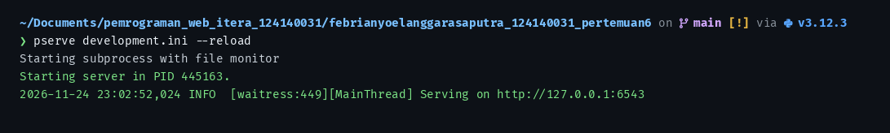

#### 2. Migrasi Database Alembic & Seeding Awal
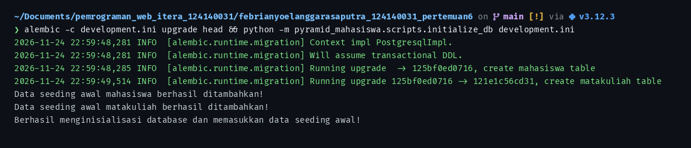

---

### B. Pengujian RESTful API Mahasiswa (Latihan Modul)
#### 3. READ ALL Mahasiswa (`GET /api/mahasiswa`)
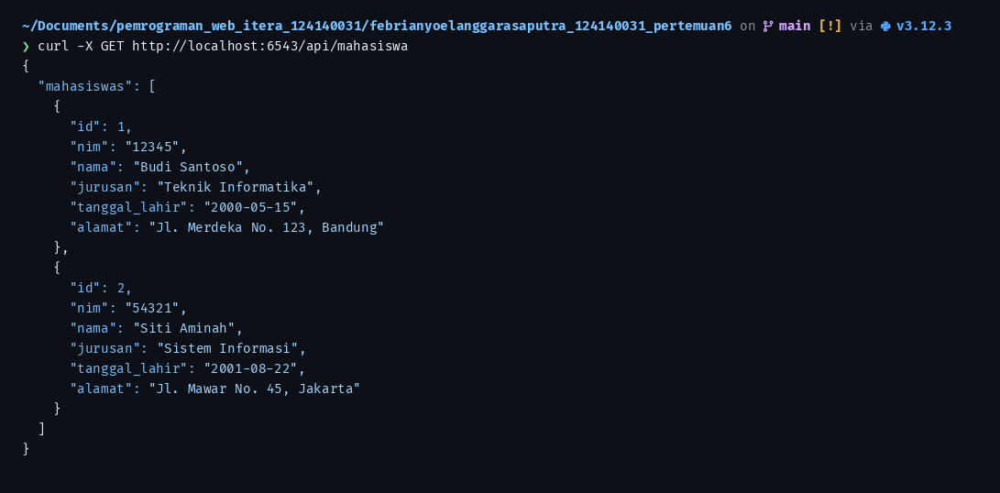

#### 4. READ ONE Mahasiswa (`GET /api/mahasiswa/1`)
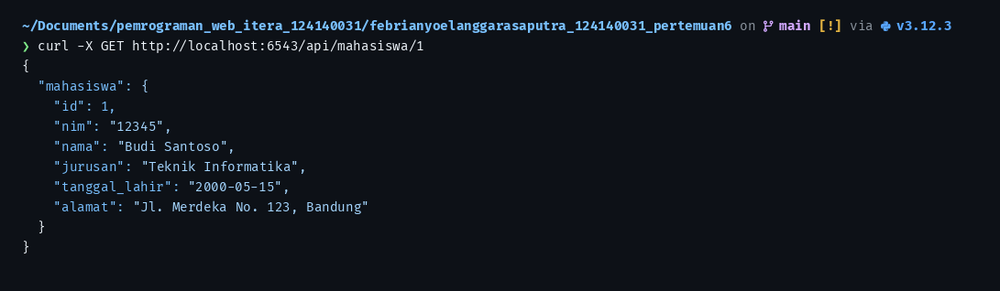

#### 5. CREATE Mahasiswa (`POST /api/mahasiswa`)
Menambahkan data mahasiswa baru atas nama **Febrian Yoel Anggara Saputra** (NIM: `124140031`):
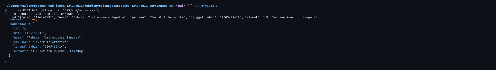

#### 6. VALIDATION ERROR Mahasiswa (`POST /api/mahasiswa` - 400 Bad Request)
Pengujian validasi saat field wajib (`nim`) tidak disertakan:
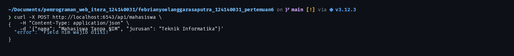

#### 7. UPDATE Mahasiswa (`PUT /api/mahasiswa/1`)
Memperbarui data nama dan alamat mahasiswa ID 1:
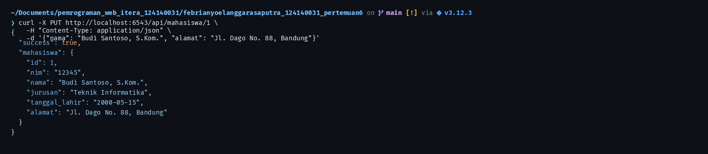

#### 8. DELETE Mahasiswa (`DELETE /api/mahasiswa/2`)
Menghapus record mahasiswa ID 2:
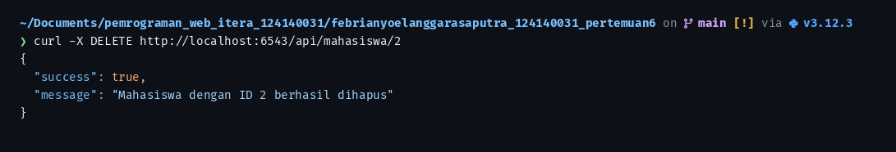

#### 9. NOT FOUND Mahasiswa (`GET /api/mahasiswa/99` - 404 Not Found)
Pengujian saat entitas mahasiswa yang dicari tidak ditemukan:
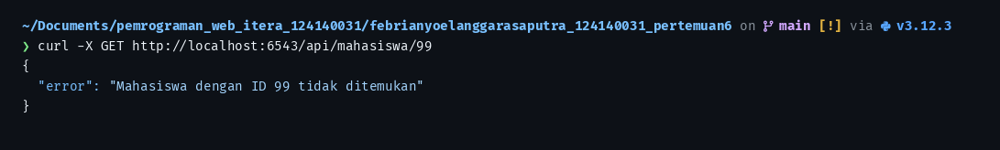

---

### C. Pengujian RESTful API Matakuliah (Tugas Praktikum)
#### 10. READ ALL Matakuliah (`GET /api/matakuliah`)
Menampilkan seluruh daftar mata kuliah awal hasil seeding:
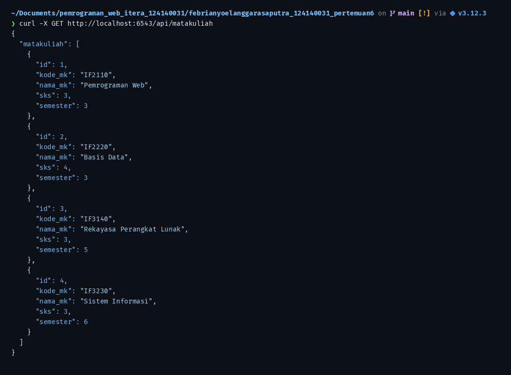

#### 11. READ ONE Matakuliah (`GET /api/matakuliah/1`)
Menampilkan detail mata kuliah ID 1:
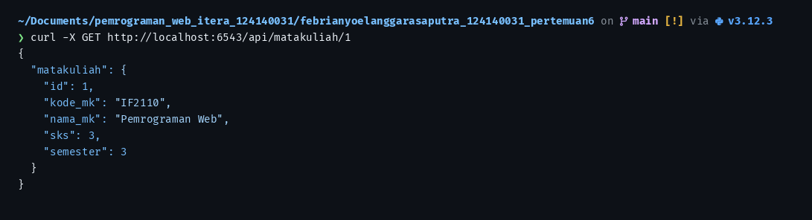

#### 12. CREATE Matakuliah (`POST /api/matakuliah`)
Menambahkan mata kuliah baru `IF4020` (Keamanan Jaringan & Informasi, 3 SKS, Semester 7):
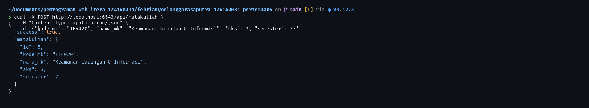

#### 13. VALIDATION ERROR Matakuliah (`POST /api/matakuliah` - 400 Bad Request)
Pengujian validasi jika SKS bernilai negatif (`-2`) atau Semester bernilai nol (`0`):
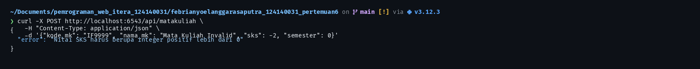

#### 14. UPDATE Matakuliah (`PUT /api/matakuliah/1`)
Memperbarui nama mata kuliah dan jumlah SKS:
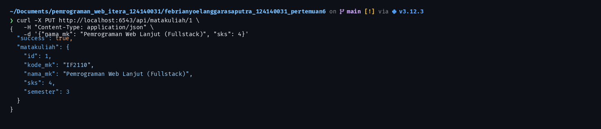

#### 15. DELETE Matakuliah (`DELETE /api/matakuliah/4`)
Menghapus data mata kuliah ID 4:


#### 16. NOT FOUND Matakuliah (`GET /api/matakuliah/99` - 404 Not Found)
Pengujian saat ID mata kuliah tidak ditemukan pada database:
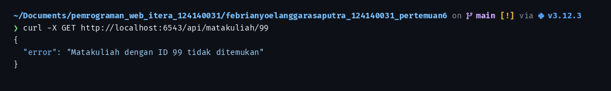

---

## 7. Kesimpulan & Pemenuhan Kriteria Penilaian

1. **Model Data & Migrasi Alembic (30%)**:
   - Model `Mahasiswa` dan `Matakuliah` telah diimplementasikan lengkap dengan method `to_dict()`.
   - Kedua model terdaftar di `models/__init__.py`.
   - Histori migrasi Alembic tersimpan di `alembic/versions/` dan sukses di-*upgrade*.
   - Seeding data awal minimal 3 mata kuliah dan data mahasiswa berjalan otomatis lewat `initialize_db.py`.
2. **Fungsionalitas API Endpoints & Routes (40%)**:
   - Seluruh 5 operasi CRUD untuk Mahasiswa dan Matakuliah berfungsi sesuai standar RESTful.
   - Penanganan status code `200 OK`, `400 Bad Request` (validasi field & nilai negatif), dan `404 Not Found` bekerja tepat.
   - Konfigurasi `routes.py` menggunakan predikat `request_method` untuk membedakan HTTP Method pada URI path yang sama.
3. **Dokumentasi README, Pengujian & Kerapian Kode (30%)**:
   - Berkas `README.md` memuat identitas lengkap praktikan, panduan eksekusi, serta bukti pengujian 16 gambar tangkapan layar.
   - Struktur folder bersih dan sesuai dengan ketentuan modul.
   - Berkas virtual environment (`venv/`) dan cache bytecode (`__pycache__/`, `*.pyc`) telah diabaikan melalui `.gitignore`.
